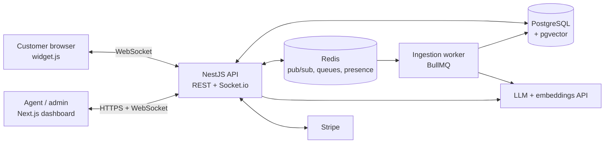

# SupportPilot

**AI customer support platform: a multi-tenant RAG chat widget with real-time human handoff.**

A business uploads its knowledge base, pastes one `<script>` tag on its site, and its customers get instant answers grounded in that business's own docs, with sources. When the AI is not confident, or the customer asks for a person, the conversation moves to a live agent inbox in real time.

> Status: in active development. Live demo, demo video and setup instructions land in Week 6 (see progress below).

## Progress

<!-- AUTO:PROGRESS -->


`[################----] 82%` - currently on **T15 Security hardening**

| Milestone | Release | Progress |
|---|---|---|
| M1 Foundation | v0.1.0 | 3/3 (done) |
| M2 Knowledge base | v0.2.0 | 3/3 (done) |
| M3 AI chat MVP | v0.3.0 | 2/2 (done) |
| M4 Human handoff | v0.4.0 | 3/3 (done) |
| M5 Business features | v0.5.0 | 2/2 (done) |
| M6 Production ready | v1.0.0 | 1/4 (in progress) |

Full plan: [docs/PLAN.md](docs/PLAN.md) · Build log: [docs/PROGRESS.md](docs/PROGRESS.md)
<!-- /AUTO:PROGRESS -->

## Features

- **Bring your own knowledge base:** upload PDF, text / markdown, or a URL; ingested in the background into pgvector
- **Grounded AI answers:** retrieval-augmented generation, streamed token by token, with source citations and a confidence score
- **One-line embeddable widget:** tiny Preact bundle in Shadow DOM, themed per tenant (colors, logo, greeting)
- **Real-time human handoff:** low confidence or "talk to a human" escalates to the agent inbox instantly; agents can hand back to AI
- **Live chat details:** typing indicators, agent presence, message history, reconnect sync
- **Analytics:** AI vs. human resolution, top questions, and an **unanswered questions report** that tells the client which docs to add
- **SaaS billing:** Stripe subscriptions with plan limits enforced from usage events
- **Security:** strict tenant isolation (scoped queries + Postgres RLS), rate limiting, prompt-injection and PII safeguards
- **Quality:** unit, integration and E2E tests plus an **eval set** that scores answer quality in CI

## Tech stack

| Layer | Choice |
|---|---|
| Dashboard | Next.js, TypeScript, Tailwind, shadcn/ui |
| Widget | Preact + Vite (single IIFE bundle, Shadow DOM) |
| API | NestJS (TypeScript), REST + Socket.io gateway |
| Real-time | Socket.io with Redis adapter |
| Database | PostgreSQL + pgvector, Drizzle ORM |
| Queues / cache | Redis + BullMQ |
| AI | LLM + embeddings API behind provider interfaces, RAG pipeline |
| Payments | Stripe subscriptions |
| DevOps | Docker, GitHub Actions, Vercel + Railway |

## Architecture



Details: [docs/ARCHITECTURE.md](docs/ARCHITECTURE.md)

## Documentation

| Doc | What is in it |
|---|---|
| [PLAN.md](docs/PLAN.md) | 6-week plan, every task with subtasks and acceptance criteria, live status |
| [ARCHITECTURE.md](docs/ARCHITECTURE.md) | System design, chat flow, RAG, handoff state machine, data model, multi-tenancy, security |
| [PIPELINE.md](docs/PIPELINE.md) | CI/CD pipeline: stages, environments, secrets, deploy and rollback |
| [TESTING.md](docs/TESTING.md) | Test layers, tenant isolation suite, coverage, the RAG eval set and its baseline |
| [WORKFLOW.md](docs/WORKFLOW.md) | How each task goes from start to done, branching, commits, PR checklist |
| [PROGRESS.md](docs/PROGRESS.md) | Dated build log |

## Run locally

Requirements: Node 22+, pnpm 10, Docker Desktop, Git (Python 3 only for the progress script).

**Windows, one step:** double-click `scripts\doctor.cmd` (or run it in a terminal). It checks every tool, installs pnpm and
dependencies, starts Postgres + Redis, runs migrations and all checks, and writes `.claude-logs\doctor.log`.

**Manual:**

```bash
cp .env.example .env            # root env for api, worker, db scripts
docker compose up -d            # PostgreSQL 16 + pgvector (host port 5434), Redis 7 (6379)
pnpm install
pnpm db:migrate                 # creates tables, enables pgvector
pnpm db:seed                    # demo tenant Acme Bikes
pnpm dev                        # api :4000, dashboard :3000, widget demo :5173, worker
                                # Bull Board queue UI (dev): http://localhost:4100
                                # widget demo page (plain HTML + snippet): http://localhost:5173
```

`pnpm dev` builds `packages/shared`, `packages/db` and `packages/ai` once, then watches the apps. If you edit those packages while it runs, also run `pnpm dev:packages` in a second terminal. If ports 3000 / 4000 / 5173 are stuck or the dashboard shows "Cannot find module" errors, run `scripts\stop-dev.cmd` and start `pnpm dev` again.

| URL | What |
|---|---|
| http://localhost:3000 | Dashboard (shows live system status) |
| http://localhost:4000/health | API health: Postgres, pgvector, Redis |
| http://localhost:5173 | Widget demo host page |

Demo logins (after `pnpm db:seed`): `owner@acme.test`, `admin@acme.test`, `agent@acme.test`, password `Password123!`.

Checks: `pnpm lint && pnpm typecheck && pnpm test` · integration tests (needs Docker running): `pnpm test:integration` ·
coverage: `pnpm test:coverage` · end-to-end: `pnpm e2e` · answer quality: `pnpm eval` (see [TESTING.md](docs/TESTING.md))

Postgres runs on host port **5434** so it never clashes with a locally installed PostgreSQL on 5432 / 5433.

### Stripe billing (optional, test mode)

Plans: **Free** (100 AI answers a month, 5 documents, 1 agent), **Pro** and **Business** (`packages/shared/src/billing.ts`).
Without Stripe keys the Billing page (owner login) shows the plan and usage meters, and upgrades are switched off.
To try a real test-mode upgrade:

1. In the Stripe dashboard (test mode) create two products with a monthly recurring price (e.g. Pro $49, Business $199),
   and in **Settings > Billing > Customer portal** allow switching between those two prices and cancelling.
2. Put `STRIPE_SECRET_KEY` (sk_test_...), `STRIPE_PRICE_PRO` and `STRIPE_PRICE_BUSINESS` (price_...) in `.env`.
3. Install the [Stripe CLI](https://docs.stripe.com/stripe-cli) (`scoop install stripe` or the Windows zip), run
   `stripe login`, then `pnpm stripe:listen`. Copy the printed `whsec_...` into `STRIPE_WEBHOOK_SECRET` and restart `pnpm dev`.
4. Sign in as `owner@acme.test`, open **Billing**, click **Upgrade to Pro** and pay with card `4242 4242 4242 4242`
   (any future date, any CVC). Back on the Billing page the plan switches to Pro once the webhook arrives.
   `stripe trigger invoice.payment_failed` or cancelling in **Manage billing** shows the other paths.

The webhook (`POST /billing/webhook`) checks the Stripe signature over the raw body, re-reads the subscription from
Stripe and applies each event id once, so replays (`stripe events resend evt_...`) change nothing.
