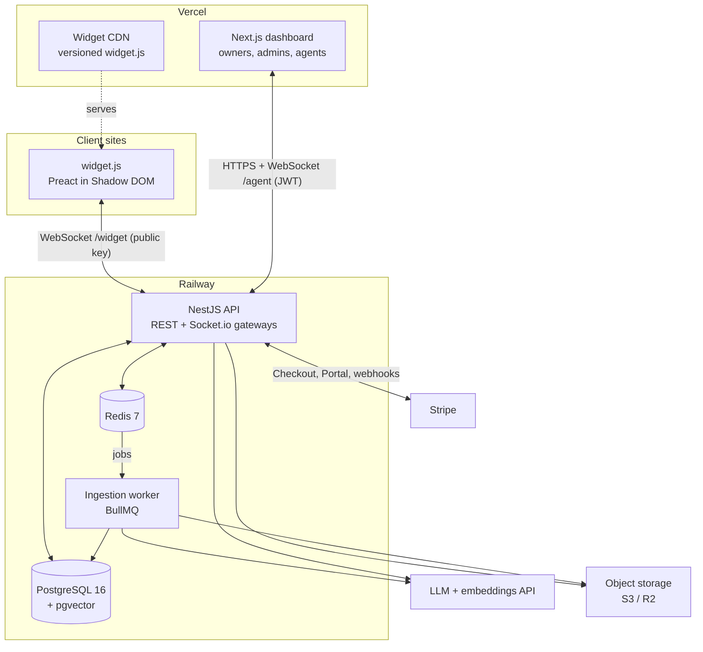
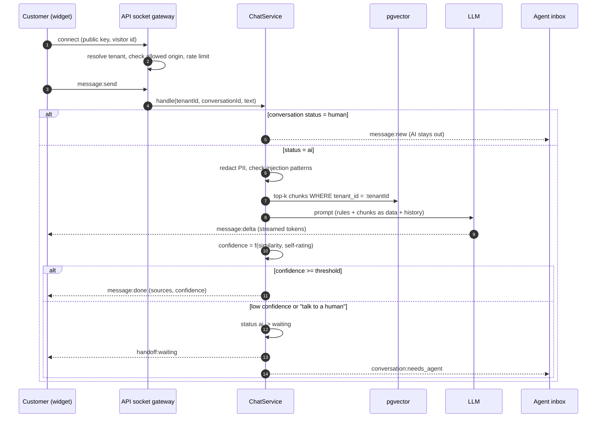
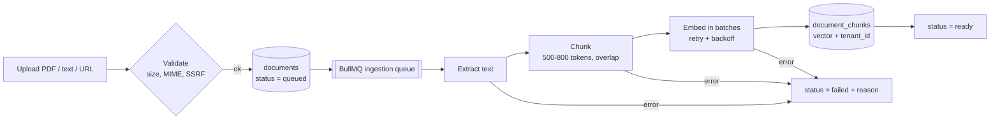
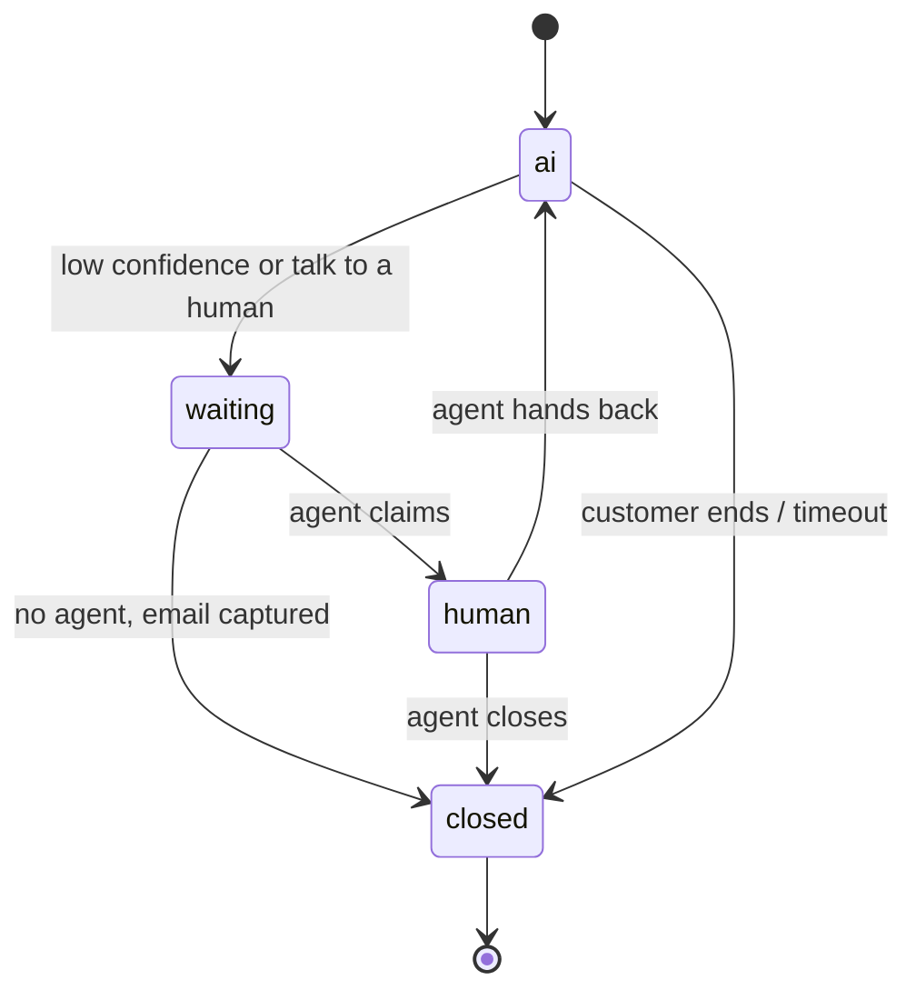
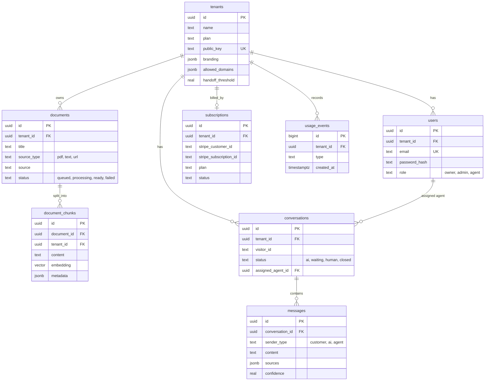
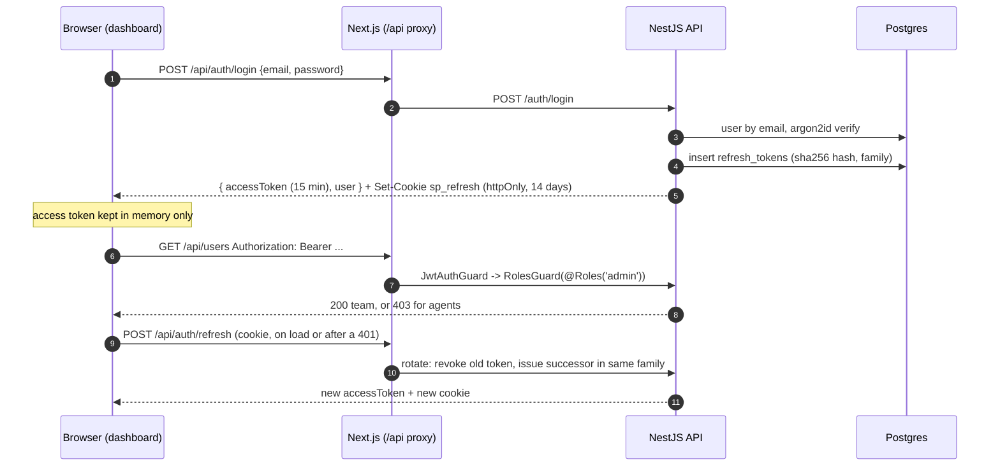

# SupportPilot - Architecture

This document is updated whenever a task changes the design. Sections marked *(planned)* describe the target design and are confirmed as tasks complete.

## 1. System overview



| Component | Responsibility |
|---|---|
| **Widget** | Branded chat UI on the client's site. Connects with the tenant's public key and an anonymous visitor id. |
| **Dashboard** | Signup, onboarding, knowledge base, agent inbox, analytics, settings, billing. |
| **API** | Auth, tenants, documents, chat (RAG), conversations, handoff, analytics, billing webhooks. One `ChatService` serves both the socket gateway and the REST/SSE endpoint. |
| **Worker** | Extract -> chunk -> embed -> store, off the request path, with retries. |
| **PostgreSQL + pgvector** | All relational data and embeddings in one database. |
| **Redis** | BullMQ queues, Socket.io adapter (multi-instance fan-out), presence, rate limits, analytics cache. |

## 2. Chat flow



1. Customer opens the widget and connects over WebSocket, identified by the tenant's public key.
2. The message goes to the backend, which embeds it and searches pgvector for the top chunks from that tenant's docs.
3. The LLM answers using only those chunks and returns a confidence score and sources.
4. High confidence: the answer is sent. Low confidence, or the customer asks for a human: the conversation is flagged *needs agent* and appears in the agent inbox in real time.
5. The agent replies from the dashboard; the AI stays out of that conversation until it is handed back.

## 3. Knowledge ingestion pipeline



- Re-indexing replaces a document's chunks inside one transaction, so search never sees a half-indexed document.
- Embeddings are cached by content hash to save API cost on re-index.
- Vector index: HNSW with `vector_cosine_ops`; every search filters on `tenant_id`.

## 4. Conversation state machine (handoff)



- All transitions go through one `HandoffService`; invalid transitions throw and are unit-tested.
- While `status = human`, the RAG pipeline is skipped entirely for that conversation.
- Threshold is per tenant (default `0.55`). Two low-confidence answers in a row also trigger a handoff.

**Confidence score** *(T07; weights and calibration re-tuned with the eval set in T14)*

```
retrieval  = mean of the cited passages' cosine similarity, rescaled per embedding model
             to 0-1 between a "floor" (unrelated) and a "ceiling" (clearly relevant):
             local-hash-v2 0.08-0.40, text-embedding-3-small 0.20-0.55
self       = the model's own 0-1 rating from its metadata line (0.5 if it gave none)
confidence = 0.6 * retrieval + 0.4 * self
           = 0 if the model reports the context has no answer, or nothing passed the floor
needs_human = confidence < tenant.handoff_threshold (default 0.55), or the customer asks for a person
```

The model ends every answer with a line `@@META {"answered": bool, "confidence": 0-1, "sources": [n]}`.
`AnswerStreamSplitter` holds back anything that could be the start of that marker, so the
customer never sees it, and the line is parsed after the stream ends. Sources are the passages
cited inline (`[1]`) or in the metadata.

## 5. Data model



`document_chunks.tenant_id` is denormalised on purpose: vector search filters on it directly, without a join.

## 6. Multi-tenancy

**Rule: every query is scoped by `tenant_id`.** It is enforced in three layers:

| Layer | How | Catches |
|---|---|---|
| 1. Request context | Tenant id comes only from the verified JWT (dashboard) or the public key (widget). The global `JwtAuthGuard` attaches `{ userId, tenantId, role }` to the request and handlers receive it with `@Auth()`. Never read from the body or query string. | Spoofed tenant ids |
| 2. Scoped data access | Repository functions take `tenantId` as a required argument; there is no unscoped query helper. | Forgotten `WHERE` clauses |
| 3. Postgres RLS *(T15)* | Row-Level Security policies on every tenant table, using `SET LOCAL app.tenant_id` per transaction. | Bugs that slip past layers 1-2 |

The tenant isolation test suite (T14) creates two tenants and asserts that no endpoint, socket event or search ever returns the other tenant's data.

## 6b. Authentication and roles (T02)



| Piece | How |
|---|---|
| Passwords | argon2id via `@node-rs/argon2` (prebuilt, no native build step). Unknown emails are verified against a dummy hash so timing does not reveal which emails exist. |
| Access token | JWT (HS256, issuer `supportpilot`), 15 minutes, claims `sub`, `tid` (tenant), `role`. Kept in React memory, never in localStorage. |
| Refresh token | 256-bit random value in an httpOnly `sp_refresh` cookie. Only its SHA-256 hash is stored. Every refresh revokes it and issues a successor in the same *family* (atomic `UPDATE ... RETURNING`, so two requests cannot both claim it). |
| Reuse detection | Presenting a revoked token more than 10 s after it was rotated means it was copied: the whole family is revoked and the user must log in again. Within 10 s it is treated as two tabs refreshing at once. |
| Roles | `owner > admin > agent`. `@Roles('admin')` means "admin or higher", enforced by the global `RolesGuard` after `JwtAuthGuard`. Routes are private by default; `@Public()` opts out (health, login, refresh, invites). |
| Invites | Owners invite admins and agents, admins invite agents. Single-use token (hash stored), 7-day expiry. No email provider yet: outside production the link is logged and returned to the dashboard. |
| Cookies across origins | The dashboard proxies `/api/*` to the API (Next.js rewrites), so the refresh cookie is first-party and `SameSite=Lax` works in dev and production. Next.js middleware redirects signed-out visitors of `/app/*` to `/login`. |

## 6c. Tenant onboarding and widget config (T03)

- **Signup** (`POST /auth/signup`) creates the tenant and its owner in one transaction, generates a `pk_live_` widget key and signs the owner in. New owners land in a three-step wizard (company, branding, install) until `tenants.onboarding_completed_at` is set.
- **Public widget key**: identifies the tenant to `widget.js`. It is public by design (it sits in the client's HTML), so it grants nothing except reading public config and, later, chatting as an anonymous visitor of that tenant. Rotation replaces it instantly.
- **`GET /widget/config?key=...`** returns only `{ tenantName, branding }`, cached for 60 s with `Vary: Origin`.
- **CORS is split by route**: `/widget/*` reflects any origin without credentials; every other route only allows the dashboard origins (with credentials). The real gate for widget routes is the per-tenant **allowed domains** check on the `Origin` header (exact host or any subdomain). An empty list means "not configured yet" and allows every site, so a new workspace can test before going live.

## 6d. RAG chat API (T07)

| Endpoint | Who | Notes |
|---|---|---|
| `POST /v1/chat` | widget.js (public key + allowed domains) | Body `{ key, visitorId, conversationId?, message }`. Streams Server-Sent Events: `meta` (conversation id), `delta` (text), `done` (content, sources, confidence, needsHuman) or `error`. |
| `POST /chat/playground` | signed-in team members | Same pipeline without a widget key, for "Test assistant" in the dashboard. |

Pipeline in `ChatService.respond()` (the socket gateway in T08 / T09 calls the same method):

1. Unknown widget key 404, blocked website 403, someone else's conversation 404, bad body 400. All of these are normal HTTP errors returned before the stream opens.
2. Store the customer message as written (agents see it as written); emails, phone numbers and Luhn-valid card numbers are masked in everything sent to the AI provider.
3. Conversation in `human` / `waiting` status: the AI stays out. "Talk to a person": a fixed handoff reply, no model call.
4. Embed the masked question, `searchChunks` top 5 for this tenant and embedding model, and drop passages below the model's similarity floor. If none remain, reply "I couldn't find that" without calling the model (saves cost).
5. Prompt: rules, then the last 6 messages, then `<context>` passages and the `<question>` as untrusted data (tags inside retrieved text are neutralised).
6. Stream the answer, compute sources and confidence, store the AI message with sources, confidence and metadata (model, first-token time, latency, retrieval scores), and record a `chat.answer` usage event.

Providers come from env. `LLM_PROVIDER=mock` (default) is an offline extractive stand-in that reads the same prompt and cites passages, so the whole pipeline runs and is tested without a key. `LLM_PROVIDER=openai` works with OpenAI or any OpenAI-compatible server (`OPENAI_BASE_URL`, e.g. a local Ollama). If the model call fails, the customer gets a polite fallback offering a person.

## 7. Real-time events *(planned, contract lives in `packages/shared`)*

| Namespace | Event | Direction | Payload |
|---|---|---|---|
| `/widget` | `message:send` | client -> server | text |
| `/widget` | `message:delta` / `message:done` | server -> client | token / final message with sources + confidence |
| `/widget` | `handoff:waiting` / `handoff:agent_joined` | server -> client | agent display name |
| both | `typing:start` / `typing:stop` | both | conversationId |
| `/agent` | `conversation:new` / `conversation:updated` | server -> client | conversation summary |
| `/agent` | `conversation:needs_agent` | server -> client | conversation summary, reason |
| `/agent` | `conversation:claim` / `conversation:handback` / `conversation:close` | client -> server | conversationId |
| `/agent` | `presence:update` | both | agentId, online / away / offline |

Rooms: `tenant:{id}` (all agents of a tenant) and `conversation:{id}` (customer + assigned agent).

## 8. Security

| Threat | Control | Task |
|---|---|---|
| Cross-tenant data access | 3-layer tenancy (above) + isolation tests | T02, T14, T15 |
| Credential theft | argon2 hashes, 15-min access tokens, rotating httpOnly refresh cookie | T02 |
| Widget embedded on a foreign site | Allowed-domains origin check on connect | T03, T08 |
| SSRF via URL ingestion | DNS resolve + block private / loopback / metadata IP ranges, size + time limits | T04 |
| Malicious uploads | Size limit, MIME + magic-byte check, parsing in the worker | T04 |
| Prompt injection | User input and retrieved docs passed as delimited untrusted data; system prompt never echoed; pattern checks; eval set includes attacks | T07, T15 |
| PII leakage | Redaction before LLM calls and in logs | T15 |
| Abuse / cost attacks | Per-IP and per-tenant rate limits, plan limits | T13, T15 |
| Forged billing events | Stripe signature verification, idempotent by event id | T13 |

## 9. Repository layout

```
supportpilot/
├─ apps/
│  ├─ api/          NestJS: REST + Socket.io gateways (health today; auth, tenants, chat... next)
│  ├─ worker/       BullMQ worker (ingestion queue)
│  ├─ dashboard/    Next.js App Router + Tailwind v4
│  └─ widget/       Preact + Vite library build -> dist/widget.js (Shadow DOM)
├─ packages/
│  ├─ ai/           text extraction (PDF, HTML), chunker, embedding providers (server-only)
│  ├─ db/           Drizzle client, schema, SQL migrations, migrate + seed scripts, chunk search
│  └─ shared/       zod schemas, env parsing, queue names, shared types (browser-safe index + /node entry)
├─ infra/postgres/  init.sql (creates the integration-test database)
├─ docs/            PLAN, ARCHITECTURE, PIPELINE, WORKFLOW, PROGRESS, plan/tasks.json
├─ scripts/         progress.py (status sync), build_docx.py (Word doc)
├─ .github/         workflows (ci, deploy, eval), PR template, dependabot
├─ docker-compose.yml          Postgres 16 + pgvector, Redis 7
├─ turbo.json, pnpm-workspace.yaml, tsconfig.base.json, eslint.config.mjs (shared by every package)
└─ .env.example
```

**How packages are consumed:** `shared` and `db` are built with tsup to CommonJS + ESM with type declarations, so the
NestJS API (CommonJS, `NodeNext` resolution), the worker, Next.js and Vite all import the same build. Turborepo builds
them first (`dependsOn: ["^build"]`). `@supportpilot/shared/node` holds server-only helpers so the browser bundles
never pull in `node:fs`.

## 10. Key decisions

| # | Decision | Alternatives | Why |
|---|---|---|---|
| D1 | pnpm + Turborepo monorepo | Separate repos, Nx | One PR can change API + widget + types together; Turborepo caching keeps CI fast. |
| D2 | NestJS | Express | Modules, DI, guards and gateways give a clear structure that is easy to explain. |
| D3 | PostgreSQL + pgvector | Pinecone, Weaviate | One database for relational data and vectors; tenant filter and similarity in one query; no extra vendor. |
| D4 | Drizzle ORM | Prisma, TypeORM | First-class `vector` column type and SQL-like queries; Prisma needs raw SQL for pgvector. |
| D5 | Socket.io + Redis adapter | Raw WebSocket, Pusher | Rooms, reconnection and horizontal scaling out of the box. |
| D6 | BullMQ | In-process jobs | Retries, backoff, concurrency limits and visibility for slow embedding jobs. |
| D7 | Preact + Shadow DOM widget | React, iframe | Small bundle; style isolation without iframe sizing / cross-frame messaging pain. |
| D8 | Provider interfaces for LLM + embeddings | Hard-coded SDK | Swap models per cost / quality; eval set compares them. |
| D9 | Vercel (dashboard, widget) + Railway (API, worker, DB, Redis) | Single VPS, AWS | Free / cheap tiers, Git-based deploys, managed Postgres with pgvector. |
| D10 | Internal packages built with tsup (CJS + ESM) | Source-only TS packages | NestJS runs compiled CommonJS on Node and cannot import raw `.ts` from a package; one build works for every consumer. |
| D11 | Jest + SWC for the API, Vitest elsewhere | One runner everywhere | Jest is NestJS's documented path; SWC keeps decorator metadata for DI and is fast. Vitest is lighter for plain TS packages. |
| D12 | One validated env schema (zod) + repo-root `.env` | Per-app dotenv, @nestjs/config | Apps fail at startup with one readable list of missing variables; same rules for API and worker. |
| D13 | Short-lived JWT in memory + rotating refresh cookie with reuse detection | Long-lived JWT in localStorage, server sessions | XSS cannot read the refresh token; a stolen refresh token is detected on reuse; the API stays stateless per request. |
| D14 | Dashboard proxies `/api/*` to the API | CORS + `SameSite=None` cookies | First-party cookie on every browser (incl. Safari ITP); no CORS preflights for the dashboard. |
| D15 | `@node-rs/argon2` for password hashing | `argon2` (node-gyp), bcrypt | argon2id is the OWASP recommendation; prebuilt binaries install cleanly on Windows, Linux and Alpine Docker. |
| D16 | zod schemas in `@supportpilot/shared` + a small `ZodValidationPipe` | class-validator DTOs | One schema validates the API body and types the dashboard form; no duplicate DTO classes. |
| D17 | CORS per route: open for `/widget/*`, dashboard-only elsewhere | One global CORS list | Client websites are unknown in advance; the allowed-domains check per tenant replaces a static CORS list for widget routes. |
| D18 | Allowed domains enforced on `Origin`, empty list = open | Always require domains | Lets a new client try the widget immediately; the dashboard nudges them to add their domain before going live. |
| D19 | `PATCH /tenant` uses a `.strict()` zod schema | Accept and ignore extra fields | Mass-assignment protection: plan, key and ids can never be changed through the settings endpoint. |
| D20 | One SSRF guard in `@supportpilot/shared/node`, used by the API (on submit) and the worker (before fetching) | Validate only in the API | DNS can change between submit and fetch; checking again right before connecting closes the gap. |
| D21 | Uploads checked by extension **and** bytes (`%PDF-` header, valid UTF-8, no NUL) | Trust the browser's Content-Type | Content-Type is client-controlled; renamed binaries are rejected before they reach the parser. |
| D22 | `StorageService` with a local-disk driver now, S3/R2 later behind the same interface | Postgres bytea, S3 from day one | Zero setup locally; production storage is a driver swap, not a refactor. |
| D23 | Embeddings behind an `EmbeddingProvider` interface; built-in offline `local-hash-v1` (feature-hashed words + word pairs) by default, OpenAI `text-embedding-3-small` via `EMBEDDING_PROVIDER=openai` | Require an API key from day one | Free, deterministic local dev / tests / CI; real semantic search is one env var away. |
| D24 | 1536-dim `vector` column + `embedding_model` stored per chunk; search filters on model | One global model, no record | Switching models never compares incompatible vectors; re-ingest migrates a tenant at its own pace. |
| D25 | HNSW index (`vector_cosine_ops`) + `hnsw.iterative_scan = strict_order` on tenant-filtered search | IVFFlat; per-tenant tables | HNSW needs no training; iterative scan stops a small tenant losing results to the post-filter. |
| D26 | Markdown-aware chunker (~700 tokens, ~100 overlap, never crosses a heading) with title + heading trail prepended before embedding | Fixed-size character windows | Chunks stay on one topic and carry their context, which lifts retrieval quality and gives citation locations. |
| D27 | `searchChunks` / `replaceDocumentChunks` in `@supportpilot/db` take `tenantId` as a required argument; replace runs in one transaction | Ad-hoc queries in services | The only search entry point is tenant-scoped, so cross-tenant leakage cannot happen by accident. |
| D28 | Ingestion pipeline is a pure function with injected repository / storage / embeddings / fetcher; BullMQ is a thin wrapper | Logic inside the BullMQ callback | Every failure path is unit-tested in milliseconds without Redis or Postgres; integration tests cover the real wiring. |
| D29 | Two failure classes: temporary (network, 429 / 5xx) retried with backoff, permanent (no text, 404, blocked URL, broken PDF, missing file) failed at once with `UnrecoverableError` | Retry everything | Retrying a 404 three times wastes time and money and delays the user seeing the real reason. |
| D30 | Crash safety from BullMQ job locks (stalled jobs are re-queued) plus idempotent chunk replacement | Manual "processing" timeouts | A killed worker never loses or duplicates a document; recovery needs no extra code. |
| D31 | Worker publishes status events on Redis pub/sub; dashboard keeps 5 s polling while anything is pending | Sockets only | Works today; T09 relays the same events over Socket.io without touching the worker. |
| D32 | Server-Sent Events over `POST /v1/chat` now; the Socket.io gateway (T08 / T09) calls the same `ChatService` | WebSockets only | SSE works through every proxy and is trivial to test with plain HTTP; one service guarantees identical answers on both transports. |
| D33 | Model metadata as a trailing `@@META {json}` line, hidden by a streaming splitter | Separate non-streamed call, JSON-only output | One call keeps first-token latency low and cost single; text still streams token by token. |
| D34 | Confidence = 0.6 x calibrated retrieval + 0.4 x model self-rating, with per-embedding-model calibration | Similarity only, model rating only | Similarity alone misses "found related text but no answer"; self-rating alone is overconfident. Calibration makes thresholds portable across embedding models. |
| D35 | Offline `mock-extractive-v1` LLM as the default provider | Require an API key; canned responses | Free local development and CI, deterministic tests, yet it exercises the real prompt, citations and confidence path. |
| D36 | Mask PII in what is sent to the AI provider, keep the original for agents | Mask everything, or nothing | Customers' contact details never leave for a third-party model, while agents can still help the person. |
| D37 | Offline embeddings bumped to `local-hash-v2` (fixed stemming); chunks keep their model name and the seed re-embeds outdated ones | Silent in-place change | Shows why `embedding_model` is stored: old and new vectors are never mixed, and re-indexing upgrades a document. |

New decisions are added here as tasks complete (also noted in PROGRESS.md).
