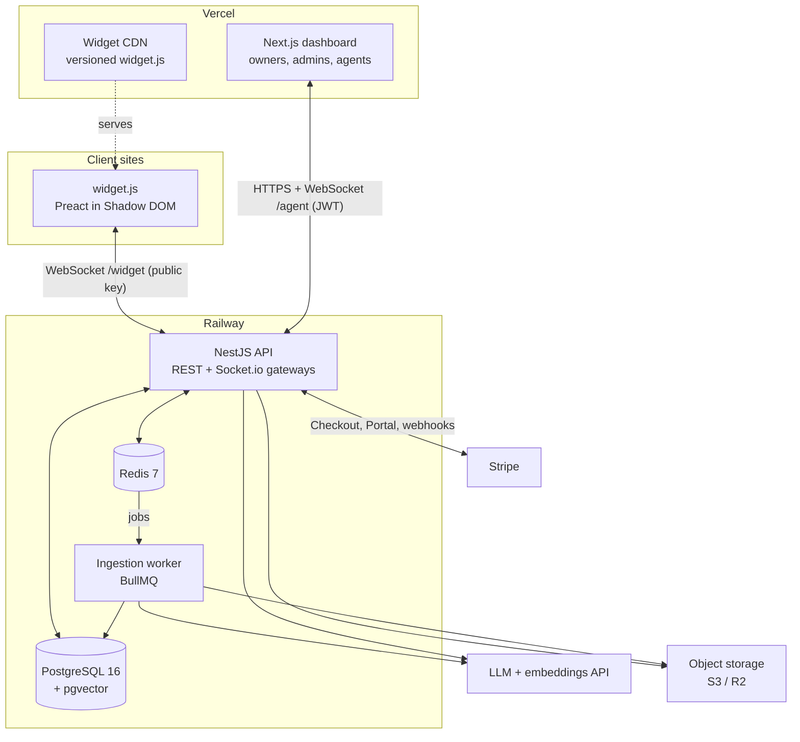
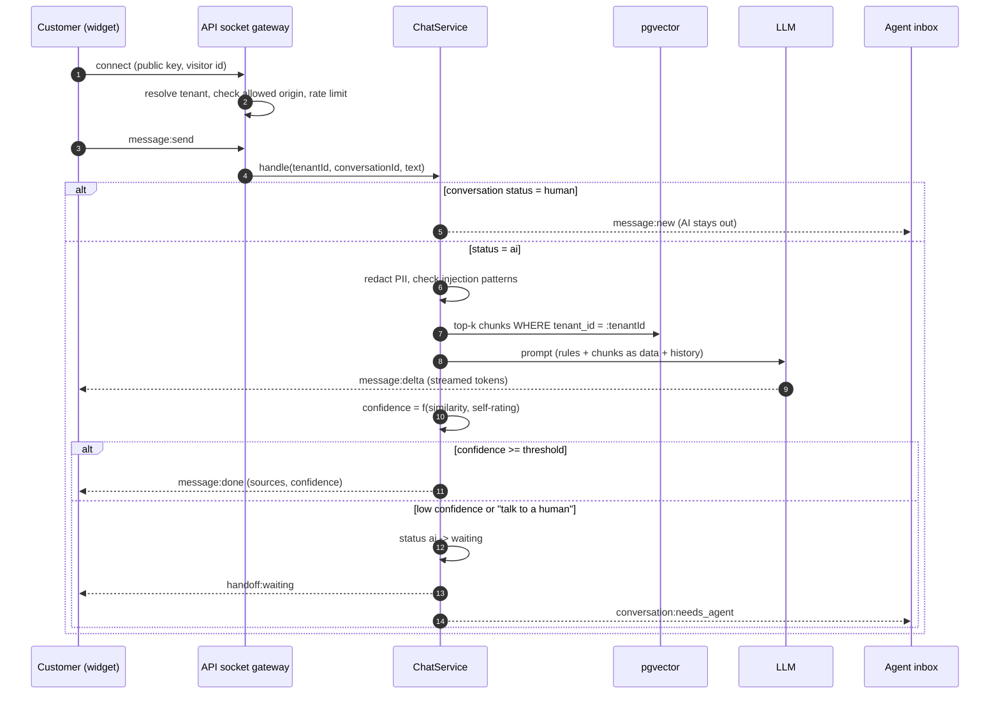
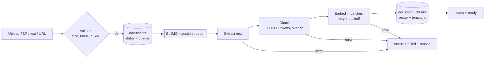
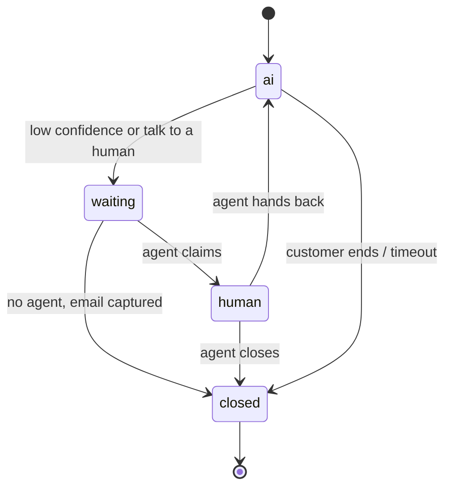
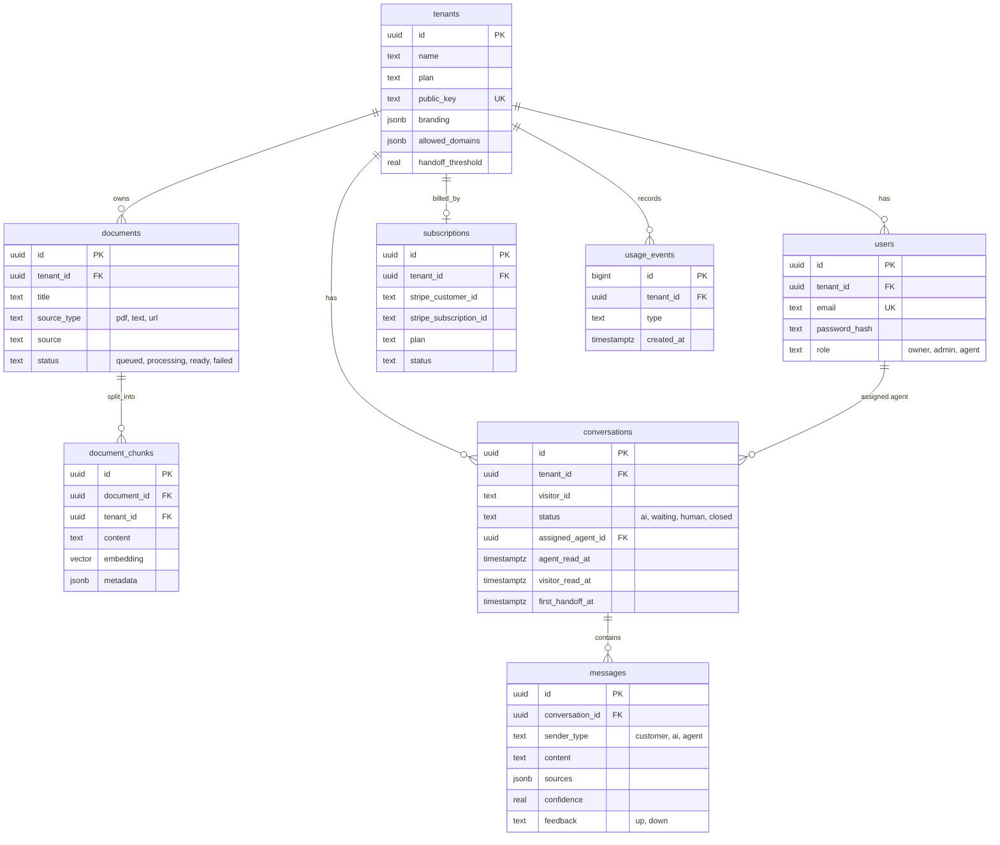
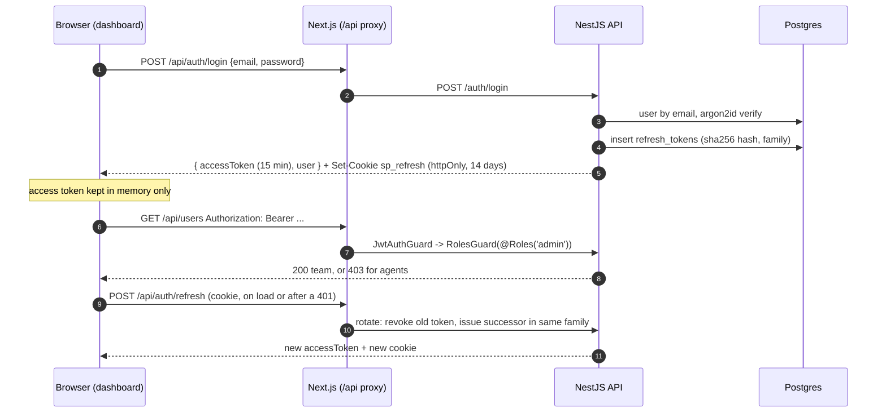

# SupportPilot - Architecture

This document is updated whenever a task changes the design. Sections marked *(planned)* describe the target design and are confirmed as tasks complete.

## 1. System overview



| Component | Responsibility |
|---|---|
| **Widget** | Branded chat UI on the client's site. Connects with the tenant's public key and an anonymous visitor id. |
| **Dashboard** | Signup, onboarding, knowledge base, agent inbox, analytics, settings, billing. |
| **API** | Auth, tenants, documents, chat (RAG), conversations, handoff, analytics, billing webhooks. One `ChatService` serves both the socket gateway and the REST/SSE endpoint. |
| **Worker** | Extract -> chunk -> embed -> store, off the request path, with retries. |
| **PostgreSQL + pgvector** | All relational data and embeddings in one database. |
| **Redis** | BullMQ queues, Socket.io adapter (multi-instance fan-out), presence, rate limits, analytics cache. |

## 2. Chat flow



1. Customer opens the widget and connects over WebSocket, identified by the tenant's public key.
2. The message goes to the backend, which embeds it and searches pgvector for the top chunks from that tenant's docs.
3. The LLM answers using only those chunks and returns a confidence score and sources.
4. High confidence: the answer is sent. Low confidence, or the customer asks for a human: the conversation is flagged *needs agent* and appears in the agent inbox in real time.
5. The agent replies from the dashboard; the AI stays out of that conversation until it is handed back.

## 3. Knowledge ingestion pipeline



- Re-indexing replaces a document's chunks inside one transaction, so search never sees a half-indexed document.
- Embeddings are cached by content hash to save API cost on re-index.
- Vector index: HNSW with `vector_cosine_ops`; every search filters on `tenant_id`.

## 4. Conversation state machine (handoff)



- Implemented in T10. The allowed transitions live in `packages/shared/src/handoff.ts` (`HANDOFF_TRANSITIONS`). Every pair of states is unit-tested, both valid and invalid. All changes go through `HandoffService`, which checks the transition and writes it with a guard on the current status (`WHERE status = <from>`), so two concurrent changes cannot both win. Each change records a system message (visible to agents, hidden from the widget) and is pushed live.
- **Triggers**: a customer asking for a person (`asksForHuman`) moves `ai -> waiting` at once. One answer below the tenant threshold (default `0.55`, set with a slider in Settings, 0.2-0.9) flags the chat under *Needs agent*. Two in a row move it to `waiting`. A confident answer resets the streak.
- **Waiting**: if an agent is online (dashboard sockets in the tenant room, counted across instances), the customer sees "Connecting you to a person...". If none is online, they get the offline reply and an email form in the widget. The email is saved on the conversation (`contact_email`) and shown in the inbox as "Follow up by email". The conversation stays `waiting` rather than `closed`, so it stays visible under *Needs agent*.
- **While `waiting` or `human`** the RAG pipeline is skipped entirely (tested). *Hand back to AI* (`human | waiting -> ai`) resumes AI answers. *Close* ends the conversation, and the widget forgets it, so the next question starts a new one. Only the assigned agent can hand back or close a `human` conversation. Playground conversations never change status.

**Confidence score** *(T07; weights and calibration re-tuned with the eval set in T14)*

```
retrieval  = mean of the cited passages' cosine similarity, rescaled per embedding model
             to 0-1 between a "floor" (unrelated) and a "ceiling" (clearly relevant):
             local-hash-v2 0.08-0.40, text-embedding-3-small 0.20-0.55
self       = the model's own 0-1 rating from its metadata line (0.5 if it gave none)
confidence = 0.6 * retrieval + 0.4 * self
           = 0 if the model reports the context has no answer, or nothing passed the floor
needs_human = confidence < tenant.handoff_threshold (default 0.55), or the customer asks for a person
```

The model ends every answer with a line `@@META {"answered": bool, "confidence": 0-1, "sources": [n]}`.
`AnswerStreamSplitter` holds back anything that could be the start of that marker, so the
customer never sees it, and the line is parsed after the stream ends. Sources are the passages
cited inline (`[1]`) or in the metadata.

## 5. Data model



`document_chunks.tenant_id` is denormalised on purpose: vector search filters on it directly, without a join.

## 6. Multi-tenancy

**Rule: every query is scoped by `tenant_id`.** It is enforced in three layers:

| Layer | How | Catches |
|---|---|---|
| 1. Request context | Tenant id comes only from the verified JWT (dashboard) or the public key (widget). The global `JwtAuthGuard` attaches `{ userId, tenantId, role }` to the request and handlers receive it with `@Auth()`. Never read from the body or query string. | Spoofed tenant ids |
| 2. Scoped data access | Repository functions take `tenantId` as a required argument; there is no unscoped query helper. | Forgotten `WHERE` clauses |
| 3. Postgres RLS *(T15)* | Row-Level Security policies on every tenant table, using `SET LOCAL app.tenant_id` per transaction. | Bugs that slip past layers 1-2 |

The tenant isolation test suite (T14) creates two tenants and asserts that no endpoint, socket event or search ever returns the other tenant's data.

## 6b. Authentication and roles (T02)



| Piece | How |
|---|---|
| Passwords | argon2id via `@node-rs/argon2` (prebuilt, no native build step). Unknown emails are verified against a dummy hash so timing does not reveal which emails exist. |
| Access token | JWT (HS256, issuer `supportpilot`), 15 minutes, claims `sub`, `tid` (tenant), `role`. Kept in React memory, never in localStorage. |
| Refresh token | 256-bit random value in an httpOnly `sp_refresh` cookie. Only its SHA-256 hash is stored. Every refresh revokes it and issues a successor in the same *family* (atomic `UPDATE ... RETURNING`, so two requests cannot both claim it). |
| Reuse detection | Presenting a revoked token more than 10 s after it was rotated means it was copied: the whole family is revoked and the user must log in again. Within 10 s it is treated as two tabs refreshing at once. |
| Roles | `owner > admin > agent`. `@Roles('admin')` means "admin or higher", enforced by the global `RolesGuard` after `JwtAuthGuard`. Routes are private by default; `@Public()` opts out (health, login, refresh, invites). |
| Invites | Owners invite admins and agents, admins invite agents. Single-use token (hash stored), 7-day expiry. No email provider yet: outside production the link is logged and returned to the dashboard. |
| Cookies across origins | The dashboard proxies `/api/*` to the API (Next.js rewrites), so the refresh cookie is first-party and `SameSite=Lax` works in dev and production. Next.js middleware redirects signed-out visitors of `/app/*` to `/login`. |

## 6c. Tenant onboarding and widget config (T03)

- **Signup** (`POST /auth/signup`) creates the tenant and its owner in one transaction, generates a `pk_live_` widget key and signs the owner in. New owners land in a three-step wizard (company, branding, install) until `tenants.onboarding_completed_at` is set.
- **Public widget key**: identifies the tenant to `widget.js`. It is public by design (it sits in the client's HTML), so it grants nothing except reading public config and, later, chatting as an anonymous visitor of that tenant. Rotation replaces it instantly.
- **`GET /widget/config?key=...`** returns only `{ tenantName, branding }`, cached for 60 s with `Vary: Origin`.
- **CORS is split by route**: `/widget/*` reflects any origin without credentials; every other route only allows the dashboard origins (with credentials). The real gate for widget routes is the per-tenant **allowed domains** check on the `Origin` header (exact host or any subdomain). An empty list means "not configured yet" and allows every site, so a new workspace can test before going live.

## 6d. RAG chat API (T07)

| Endpoint | Who | Notes |
|---|---|---|
| `POST /v1/chat` | widget.js (public key + allowed domains) | Body `{ key, visitorId, conversationId?, message }`. Streams Server-Sent Events: `meta` (conversation id), `delta` (text), `done` (content, sources, confidence, needsHuman) or `error`. |
| `POST /chat/playground` | signed-in team members | Same pipeline without a widget key, for "Test assistant" in the dashboard. |

Pipeline in `ChatService.respond()` (the socket gateway in T08 / T09 calls the same method):

1. Unknown widget key 404, blocked website 403, someone else's conversation 404, bad body 400. All of these are normal HTTP errors returned before the stream opens.
2. Store the customer message as written (agents see it as written); emails, phone numbers and Luhn-valid card numbers are masked in everything sent to the AI provider.
3. Conversation in `human` / `waiting` status: the AI stays out. "Talk to a person": a fixed handoff reply, no model call.
4. Embed the masked question, `searchChunks` top 5 for this tenant and embedding model, and drop passages below the model's similarity floor. If none remain, reply "I couldn't find that" without calling the model (saves cost).
5. Prompt: rules, then the last 6 messages, then `<context>` passages and the `<question>` as untrusted data (tags inside retrieved text are neutralised).
6. Stream the answer, compute sources and confidence, store the AI message with sources, confidence and metadata (model, first-token time, latency, retrieval scores), and record a `chat.answer` usage event.

Providers come from env. `LLM_PROVIDER=mock` (default) is an offline extractive stand-in that reads the same prompt and cites passages, so the whole pipeline runs and is tested without a key. `LLM_PROVIDER=openai` works with OpenAI or any OpenAI-compatible server (`OPENAI_BASE_URL`, e.g. a local Ollama). If the model call fails, the customer gets a polite fallback offering a person.

## 6e. Embeddable widget (T08)

```html
<script src="https://widget.example.com/widget.js" data-supportpilot data-key="pk_live_..." async></script>
```

- **One IIFE bundle** (Preact + socket.io-client) built by Vite in library mode. `scripts/check-size.mjs` fails the build above 60 KB gzipped; widget code imports only *types* from `@supportpilot/shared`, so zod never reaches client websites.
- **Shadow DOM**: the widget mounts in `<div id="supportpilot-widget">` with an open shadow root and `:host { all: initial }`. Host CSS cannot style it, and its CSS cannot leak out. The demo page (`apps/widget/public/index.html`) has deliberately hostile CSS to prove it.
- **Lazy connection**: `GET /widget/config` on load (branding; hidden on 403 / 404). The Socket.io connection opens only when the visitor first opens the chat.
- **Identity**: an anonymous random `visitorId` and the current `conversationId` are kept in `localStorage` per widget key, with an in-memory fallback when storage is blocked. No cookies, no fingerprinting. After a reload, `conversation:history` restores the chat, but only for the visitor that owns it.
- **Handshake check**: namespace middleware validates `{ key, visitorId }` and the tenant's allowed domains against the `Origin` header (same rules as `/widget/config` and `POST /v1/chat`). Refusals arrive as `connect_error` with the reason.
- **Per-connection limits**: one answer at a time (`busy`), 20 messages per minute (`rate_limited`). Answers stream as `message:delta` and finish with `message:done`, from the same `ChatService` as SSE. Closing the tab aborts generation.
- **UI**: launcher, branded header, streaming text with a typing indicator, source list (links for URL imports), "Talk to a person", reconnect banner, Escape to close, full screen on phones, reduced-motion support.
- **Local development**: `pnpm dev` rebuilds `dist/widget.js` on change and serves `dist/` on :5173. The dashboard's install snippet and "Preview on a demo page" link (`try.html?key=`) load the real bundle.

## 6f. Agent inbox (T09)

**Commands over REST, events over WebSockets.** Agents act through ordinary authenticated endpoints, and every change is pushed to everyone who needs to see it:

| Endpoint (agent+) | Purpose |
|---|---|
| `GET /conversations?tab=needs_agent\|mine\|team\|ai\|closed` | List (100 most recent) plus counts for every tab |
| `GET /conversations/:id` | Full history with AI sources, confidence and the hand-off flag |
| `POST /conversations/:id/claim` | Take the conversation (status -> `human`); 409 "Already taken by ..." if another agent has it |
| `POST /conversations/:id/messages` | Agent reply (claims an unassigned conversation first); pushed to the widget instantly |

- **Tabs**: *Needs agent* = `waiting`, or `ai` with a low-confidence answer (`low_confidence_streak > 0`). *Mine* / *Other agents* = `human`, split by `assigned_agent_id`. *AI-handled* = `ai` with no problem. *Closed*. Playground conversations are excluded. The same rules live in SQL filters and in `inboxTabFor()` in the shared package.
- **Exclusive claim**: one conditional `UPDATE ... WHERE assigned_agent_id IS NULL OR = me RETURNING`. Postgres row locking makes exactly one of two simultaneous clicks win, and the other gets 409 with the winner's name.
- **Push**: `RealtimeService` is the only place that emits. `conversation:upsert` (summary) and `message:new` go to room `tenant:{id}` on `/agent`. Agent replies and `conversation:status` go to room `conversation:{id}` on `/widget`. `ChatService` notifies the inbox after every customer message and AI answer, and inbox failures never break the customer's chat.
- **Dashboard socket**: `/agent` handshake with the access token (`auth: { token }`). On "invalid or expired" the dashboard refreshes the token and reconnects. After any reconnect it refetches the list and the open conversation, so missed events cannot leave it stale.
- **Scaling**: `RedisIoAdapter` (`@socket.io/redis-adapter`) makes room emits reach sockets on every API instance. The integration test runs **two API instances** in one process: the widget is on instance B and the dashboard on A. Worker document-status events are relayed with `namespace.local` (each instance receives the Redis message itself), so dashboards get each event once.

## 6g. Typing, presence and history (T11)

- **One contract**: every socket event and its payload type lives in `packages/shared/src/realtime.ts` (zod schemas for anything a client sends). The API validates with the schemas, and the dashboard and widget use the same types. The widget imports only types plus the zod-free `@supportpilot/shared/typing` entry, so zod never reaches client websites (bundle 23.8 KB gzipped).
- **Typing**: `createTypingNotifier()` (shared) sends `typing: true` on the first keystroke, repeats it at most every 2 s, and sends `false` after 3 s idle or on send. Receivers hide the indicator after 6 s even if the stop is lost. The server relays immediately (well under 300 ms, tested across two instances). A widget can only send typing for a conversation it owns (its socket joined that room after the owner check), and an agent only for one in their tenant. Both sides are capped at 20 typing events per 10 s.
- **Presence**: each dashboard tab writes `presence:{tenant}:tab:{user}:{tab}` = `online | away` with a 30 s TTL and refreshes it with a heartbeat every 10 s. A closed tab deletes its key at once, and a crashed one expires. Each API instance sweeps every 5 s. A `SET ... GET` swap of the last announced snapshot makes exactly one instance announce a change (`presence:update` to dashboards, and `presence` to widgets when "anyone online" flips). Agents choose Online or Away in the sidebar. Away agents do not count for hand-offs, so customers get the email form.
- **History**: keyset pagination on `(created_at, id)`, with the cursor compared inside SQL so microsecond timestamps are not rounded. Pages are 50 messages (max 100). The widget's `conversation:history` takes `before` (Load earlier messages) or `after` (missed messages after a reconnect) and returns the status, the unread count and the agent read time. The agent view uses `GET /conversations/:id` (latest page + `hasMore`) and `GET /conversations/:id/messages?before|after=`. Another tenant's conversation is a 404.
- **Read receipts and unread**: `POST /conversations/:id/read` (agent opens the conversation, or a customer message arrives while it is open and visible) sets `agent_read_at`, clears the unread count and sends `conversation:read` to the widget ("Seen" under the customer's last message). The widget emits `conversation:read` while the chat is open, which sets `visitor_read_at` ("Seen" under the agent's last reply). Unread counts only customer messages in `waiting` / `human` conversations. The widget launcher shows a count badge.
- **Reconnects**: the widget asks for messages `after` the last one it has and merges them without duplicates. If too much was missed, it reloads the latest page. The dashboard does the same for the open conversation and refetches the list.

## 6h. Analytics (T12)

- **API** (admin+): `GET /analytics?from&to&tz[&fresh=1]` returns KPIs, one row per day, top questions and the unanswered-questions report in one response; `GET /analytics/export?report=daily|questions|unanswered` returns the same data as CSV (UTF-8 with BOM for Excel). Dates are inclusive local days in the viewer's IANA time zone (validated); the default is the last 30 days, the maximum 366.
- **KPIs**: conversations, AI-resolved (no person ever involved) vs handed off, average first response (customer's first message -> first AI or agent reply), average agent response after a hand-off, AI answers, thumbs up / down and the satisfaction rate. `conversations.first_handoff_at` is set the first time a chat goes to `waiting` or is claimed and survives "Hand back to AI", so a chat that bounced back still counts as handed off. Migration 0008 backfills it for older chats.
- **Ratings**: the widget shows thumbs up / down under every AI answer (`message:feedback` socket event, own conversation and AI messages only, 10 clicks per 10 s, clicking again takes the rating back). Agents see the rating in the inbox.
- **Question reports**: the newest 2,000 customer questions in the range are paired with the reply that came next. "Talk to a person" requests are left out, PII is masked. Each distinct text (lower-cased, punctuation trimmed) is embedded once with the tenant's embedding model and grouped by greedy centroid clustering (`packages/ai/src/cluster.ts`, threshold per model: 0.42 for the lexical offline model, 0.7 for OpenAI small). A question is *unanswered* when the AI's answer had low confidence, found nothing (`no_answer`), or got a thumbs down. Each group shows its count, reasons, other wordings, the last time it was asked, links to up to three chats and an **Add doc** button that opens Knowledge base with a "Write an answer" form (`POST /documents/text`, stored as a `.md` upload and ingested like any file). If the embedding provider fails, grouping falls back to the offline model.
- **Tenant scoping**: every query filters `tenant_id` on conversations *and* on messages (defence in depth) and excludes playground chats; the Redis cache key is `analytics:v1:{tenant}:{from}:{to}:{tz}` with a 5-minute TTL. Integration tests check that another tenant's identical questions never appear and that two tenants with the same range get separate cache entries.
- **Dashboard**: `/app/analytics` with presets (7 / 30 / 90 days) and a custom range, KPI tiles, two Recharts bar charts (conversations stacked AI-resolved / handed off; helpful / not helpful) plus a table view, the unanswered report, top questions and CSV buttons. `pnpm db:seed` adds about 30 days of demo chats (`v_demo_` visitors, deterministic) so the page has meaningful data.

## 7. Real-time events *(contract in `packages/shared/src/realtime.ts`)*

| Namespace | Event | Direction | Payload |
|---|---|---|---|
| `/widget` | `message:send` (ack) | client -> server | conversationId?, message |
| `/widget` | `message:delta` / `message:done` / `message:error` | server -> client | text / final message with sources + confidence / error code |
| `/widget` | `message:new` | server -> client | agent reply |
| `/widget` | `conversation:status` | server -> client | status, agent name, agentsOnline |
| `/widget` | `conversation:history` (ack) | client -> server | conversationId, before? / after?, limit? |
| `/widget` | `ticket:email` (ack) | client -> server | conversationId, email |
| both | `typing` | both | conversationId, typing (+ who, from the server) |
| `/widget` | `conversation:read` | both | visitor read (client) / agent read receipt (server) |
| `/widget` | `presence` | server -> client | agentsOnline |
| `/agent` | `conversation:upsert` / `message:new` / `document:status` | server -> client | summary / message / document status |
| `/agent` | `presence:set` / `presence:heartbeat` | client -> server | online or away / none |
| `/agent` | `presence:update` | server -> client | every team member with online / away / offline |

Agent commands that change data (claim, reply, hand back, close, read) are REST endpoints (D42). Rooms: `tenant:{id}` on `/agent` (all agents of a tenant), `conversation:{id}` on `/widget` (the visitor's sockets after the owner check) and `widgets:{tenantId}` on `/widget` (presence changes).

## 8. Security

| Threat | Control | Task |
|---|---|---|
| Cross-tenant data access | 3-layer tenancy (above) + isolation tests | T02, T14, T15 |
| Credential theft | argon2 hashes, 15-min access tokens, rotating httpOnly refresh cookie | T02 |
| Widget embedded on a foreign site | Allowed-domains origin check on connect | T03, T08 |
| SSRF via URL ingestion | DNS resolve + block private / loopback / metadata IP ranges, size + time limits | T04 |
| Malicious uploads | Size limit, MIME + magic-byte check, parsing in the worker | T04 |
| Prompt injection | User input and retrieved docs passed as delimited untrusted data; system prompt never echoed; pattern checks; eval set includes attacks | T07, T15 |
| PII leakage | Redaction before LLM calls and in logs | T15 |
| Abuse / cost attacks | Per-IP and per-tenant rate limits, plan limits | T13, T15 |
| Forged billing events | Stripe signature verification, idempotent by event id | T13 |

## 9. Repository layout

```
supportpilot/
├─ apps/
│  ├─ api/          NestJS: REST + Socket.io gateways (health today; auth, tenants, chat... next)
│  ├─ worker/       BullMQ worker (ingestion queue)
│  ├─ dashboard/    Next.js App Router + Tailwind v4
│  └─ widget/       Preact + Vite library build -> dist/widget.js (Shadow DOM)
├─ packages/
│  ├─ ai/           text extraction (PDF, HTML), chunker, embedding providers (server-only)
│  ├─ db/           Drizzle client, schema, SQL migrations, migrate + seed scripts, chunk search
│  └─ shared/       zod schemas, env parsing, queue names, shared types (browser-safe index + /node entry)
├─ infra/postgres/  init.sql (creates the integration-test database)
├─ docs/            PLAN, ARCHITECTURE, PIPELINE, WORKFLOW, PROGRESS, plan/tasks.json
├─ scripts/         progress.py (status sync), build_docx.py (Word doc)
├─ .github/         workflows (ci, deploy, eval), PR template, dependabot
├─ docker-compose.yml          Postgres 16 + pgvector, Redis 7
├─ turbo.json, pnpm-workspace.yaml, tsconfig.base.json, eslint.config.mjs (shared by every package)
└─ .env.example
```

**How packages are consumed:** `shared` and `db` are built with tsup to CommonJS + ESM with type declarations, so the
NestJS API (CommonJS, `NodeNext` resolution), the worker, Next.js and Vite all import the same build. Turborepo builds
them first (`dependsOn: ["^build"]`). `@supportpilot/shared/node` holds server-only helpers so the browser bundles
never pull in `node:fs`.

## 10. Key decisions

| # | Decision | Alternatives | Why |
|---|---|---|---|
| D1 | pnpm + Turborepo monorepo | Separate repos, Nx | One PR can change API + widget + types together; Turborepo caching keeps CI fast. |
| D2 | NestJS | Express | Modules, DI, guards and gateways give a clear structure that is easy to explain. |
| D3 | PostgreSQL + pgvector | Pinecone, Weaviate | One database for relational data and vectors; tenant filter and similarity in one query; no extra vendor. |
| D4 | Drizzle ORM | Prisma, TypeORM | First-class `vector` column type and SQL-like queries; Prisma needs raw SQL for pgvector. |
| D5 | Socket.io + Redis adapter | Raw WebSocket, Pusher | Rooms, reconnection and horizontal scaling out of the box. |
| D6 | BullMQ | In-process jobs | Retries, backoff, concurrency limits and visibility for slow embedding jobs. |
| D7 | Preact + Shadow DOM widget | React, iframe | Small bundle; style isolation without iframe sizing / cross-frame messaging pain. |
| D8 | Provider interfaces for LLM + embeddings | Hard-coded SDK | Swap models per cost / quality; eval set compares them. |
| D9 | Vercel (dashboard, widget) + Railway (API, worker, DB, Redis) | Single VPS, AWS | Free / cheap tiers, Git-based deploys, managed Postgres with pgvector. |
| D10 | Internal packages built with tsup (CJS + ESM) | Source-only TS packages | NestJS runs compiled CommonJS on Node and cannot import raw `.ts` from a package; one build works for every consumer. |
| D11 | Jest + SWC for the API, Vitest elsewhere | One runner everywhere | Jest is NestJS's documented path; SWC keeps decorator metadata for DI and is fast. Vitest is lighter for plain TS packages. |
| D12 | One validated env schema (zod) + repo-root `.env` | Per-app dotenv, @nestjs/config | Apps fail at startup with one readable list of missing variables; same rules for API and worker. |
| D13 | Short-lived JWT in memory + rotating refresh cookie with reuse detection | Long-lived JWT in localStorage, server sessions | XSS cannot read the refresh token; a stolen refresh token is detected on reuse; the API stays stateless per request. |
| D14 | Dashboard proxies `/api/*` to the API | CORS + `SameSite=None` cookies | First-party cookie on every browser (incl. Safari ITP); no CORS preflights for the dashboard. |
| D15 | `@node-rs/argon2` for password hashing | `argon2` (node-gyp), bcrypt | argon2id is the OWASP recommendation; prebuilt binaries install cleanly on Windows, Linux and Alpine Docker. |
| D16 | zod schemas in `@supportpilot/shared` + a small `ZodValidationPipe` | class-validator DTOs | One schema validates the API body and types the dashboard form; no duplicate DTO classes. |
| D17 | CORS per route: open for `/widget/*`, dashboard-only elsewhere | One global CORS list | Client websites are unknown in advance; the allowed-domains check per tenant replaces a static CORS list for widget routes. |
| D18 | Allowed domains enforced on `Origin`, empty list = open | Always require domains | Lets a new client try the widget immediately; the dashboard nudges them to add their domain before going live. |
| D19 | `PATCH /tenant` uses a `.strict()` zod schema | Accept and ignore extra fields | Mass-assignment protection: plan, key and ids can never be changed through the settings endpoint. |
| D20 | One SSRF guard in `@supportpilot/shared/node`, used by the API (on submit) and the worker (before fetching) | Validate only in the API | DNS can change between submit and fetch; checking again right before connecting closes the gap. |
| D21 | Uploads checked by extension **and** bytes (`%PDF-` header, valid UTF-8, no NUL) | Trust the browser's Content-Type | Content-Type is client-controlled; renamed binaries are rejected before they reach the parser. |
| D22 | `StorageService` with a local-disk driver now, S3/R2 later behind the same interface | Postgres bytea, S3 from day one | Zero setup locally; production storage is a driver swap, not a refactor. |
| D23 | Embeddings behind an `EmbeddingProvider` interface; built-in offline `local-hash-v1` (feature-hashed words + word pairs) by default, OpenAI `text-embedding-3-small` via `EMBEDDING_PROVIDER=openai` | Require an API key from day one | Free, deterministic local dev / tests / CI; real semantic search is one env var away. |
| D24 | 1536-dim `vector` column + `embedding_model` stored per chunk; search filters on model | One global model, no record | Switching models never compares incompatible vectors; re-ingest migrates a tenant at its own pace. |
| D25 | HNSW index (`vector_cosine_ops`) + `hnsw.iterative_scan = strict_order` on tenant-filtered search | IVFFlat; per-tenant tables | HNSW needs no training; iterative scan stops a small tenant losing results to the post-filter. |
| D26 | Markdown-aware chunker (~700 tokens, ~100 overlap, never crosses a heading) with title + heading trail prepended before embedding | Fixed-size character windows | Chunks stay on one topic and carry their context, which lifts retrieval quality and gives citation locations. |
| D27 | `searchChunks` / `replaceDocumentChunks` in `@supportpilot/db` take `tenantId` as a required argument; replace runs in one transaction | Ad-hoc queries in services | The only search entry point is tenant-scoped, so cross-tenant leakage cannot happen by accident. |
| D28 | Ingestion pipeline is a pure function with injected repository / storage / embeddings / fetcher; BullMQ is a thin wrapper | Logic inside the BullMQ callback | Every failure path is unit-tested in milliseconds without Redis or Postgres; integration tests cover the real wiring. |
| D29 | Two failure classes: temporary (network, 429 / 5xx) retried with backoff, permanent (no text, 404, blocked URL, broken PDF, missing file) failed at once with `UnrecoverableError` | Retry everything | Retrying a 404 three times wastes time and money and delays the user seeing the real reason. |
| D30 | Crash safety from BullMQ job locks (stalled jobs are re-queued) plus idempotent chunk replacement | Manual "processing" timeouts | A killed worker never loses or duplicates a document; recovery needs no extra code. |
| D31 | Worker publishes status events on Redis pub/sub; dashboard keeps 5 s polling while anything is pending | Sockets only | Works today; T09 relays the same events over Socket.io without touching the worker. |
| D32 | Server-Sent Events over `POST /v1/chat` now; the Socket.io gateway (T08 / T09) calls the same `ChatService` | WebSockets only | SSE works through every proxy and is trivial to test with plain HTTP; one service guarantees identical answers on both transports. |
| D33 | Model metadata as a trailing `@@META {json}` line, hidden by a streaming splitter | Separate non-streamed call, JSON-only output | One call keeps first-token latency low and cost single; text still streams token by token. |
| D34 | Confidence = 0.6 x calibrated retrieval + 0.4 x model self-rating, with per-embedding-model calibration | Similarity only, model rating only | Similarity alone misses "found related text but no answer"; self-rating alone is overconfident. Calibration makes thresholds portable across embedding models. |
| D35 | Offline `mock-extractive-v1` LLM as the default provider | Require an API key; canned responses | Free local development and CI, deterministic tests, yet it exercises the real prompt, citations and confidence path. |
| D36 | Mask PII in what is sent to the AI provider, keep the original for agents | Mask everything, or nothing | Customers' contact details never leave for a third-party model, while agents can still help the person. |
| D37 | Offline embeddings bumped to `local-hash-v2` (fixed stemming); chunks keep their model name and the seed re-embeds outdated ones | Silent in-place change | Shows why `embedding_model` is stored: old and new vectors are never mixed, and re-indexing upgrades a document. |
| D38 | Socket.io for the widget, SSE kept for `POST /v1/chat` | One transport only | Sockets are needed anyway for agent replies and typing (T09-T11); SSE stays as the simple public HTTP API. Both call `ChatService.respond`. |
| D39 | Widget imports only types from the shared package; constants duplicated where needed | Import shared values | Importing values would bundle zod (+15 KB gzipped) into every client website. |
| D40 | Anonymous `visitorId` in localStorage, history only for the owning visitor | Cookies, login for visitors | Works on any site without cookie banners; a leaked conversation id is useless without the matching visitor id. |
| D41 | Widget dev server serves the built bundle (build --watch + preview) | Vite dev modules | The demo page and install snippet test exactly what client sites load, including the size budget. |
| D42 | Agent commands over REST, live updates over Socket.io | Commands as socket events | REST gives status codes, validation pipes, guards and simple tests; sockets only fan out state. |
| D43 | Exclusive claim with one conditional UPDATE | Redis lock, SELECT then UPDATE | Atomic in the database that owns the data; no lock expiry edge cases; the race is covered by a test. |
| D44 | `@socket.io/redis-adapter` from the first socket feature | Sticky single instance | Horizontal scaling works from day one and is tested with two API instances. |
| D45 | One `RealtimeService` emits everything; list refetch on upsert (debounced) | Patch client state from each event | Fewer moving parts: events say "something changed" and REST stays the source of truth; refetch after reconnect covers missed events. |
| D46 | State machine as data in the shared package + status-guarded UPDATEs | Ad-hoc status writes in services | One table to read, test and explain; the guard makes every transition race-safe. |
| D47 | Offline tickets stay `waiting` with a contact email | Close them (as first planned) | A closed ticket would vanish from *Needs agent*, but someone still has to reply. |
| D48 | "Agents online" = live dashboard sockets in the tenant room (`fetchSockets` across instances) | Separate presence store now | Accurate enough for the hand-off decision today; T11 adds presence with heartbeats and away state. *(Replaced by D49 in T11.)* |
| D49 | Presence = one Redis key per tab with a 30 s TTL + 10 s heartbeats + a 5 s sweep | Socket counts, a DB column | Crashed tabs go offline by themselves, multiple tabs combine (online wins over away), and it works across instances. Replaces D48. |
| D50 | Announce presence changes with a `SET ... GET` swap of the last snapshot | Pub/sub of every heartbeat | Steady heartbeats cost two Redis calls and no events; when several instances see the same change only one emits. |
| D51 | Keyset pagination on `(created_at, id)` with the cursor compared in SQL | Offset paging, cursor as a JS Date | Stable when new messages arrive and exact with Postgres microseconds; the same helper serves the widget, the agent view and reconnect sync. |
| D52 | Read state as two timestamps on the conversation (`agent_read_at`, `visitor_read_at`) | Per-message receipts, per-agent read state | Enough for "Seen" and unread counts with no extra table; per-agent state can come later if teams need it. |
| D53 | A zod-free `@supportpilot/shared/typing` entry for the widget | Duplicate the throttle in the widget | One tested implementation for both clients without bundling zod (D39). |
| D54 | Analytics computed live from `conversations` / `messages` with a 5-minute Redis cache | Nightly rollup tables, a separate analytics store | Exact numbers for any range and time zone with no extra jobs; indexed queries on `(tenant_id, created_at)` are fast at this scale. Rollups can come later if a tenant grows large. |
| D55 | `first_handoff_at` timestamp on the conversation | Infer hand-offs from system messages or `handoff_reason` | `handoff_reason` is cleared on hand back and system texts are for people; one column makes AI-resolved vs handed off a simple, indexed filter. |
| D56 | Group questions at report time by embedding each distinct text once + greedy centroid clustering | Store a vector per message, k-means, an LLM to label topics | No schema or write-path cost, deterministic, a few hundred embeddings per report at most (and cached); thresholds are calibrated per embedding model like retrieval (D35). |
| D57 | CSV cells starting with `= + - @` get a leading apostrophe | Export raw text | Customer questions are untrusted; this stops CSV formula injection when a client opens the export in Excel. |
| D58 | "Add doc" writes a markdown upload through the normal upload path | A separate article table | Same file checks, storage, ingestion and re-index as any document; nothing new to maintain. |

New decisions are added here as tasks complete (also noted in PROGRESS.md).
