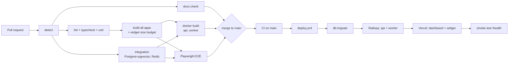

# SupportPilot - CI/CD Pipeline

Three GitHub Actions workflows live in [`.github/workflows`](../.github/workflows):

| Workflow | File | Trigger | Purpose | Active from |
|---|---|---|---|---|
| **CI** | `ci.yml` | every PR, push to `main` | Docs sync, lint, types, unit + integration tests, build, widget size budget, Docker build, E2E | now (code jobs switch on at T01) |
| **Deploy** | `deploy.yml` | CI success on `main`, manual | Migrate DB, deploy API + worker (Railway) and dashboard + widget (Vercel), smoke test | T16 (`DEPLOY_ENABLED=true`) |
| **RAG Eval** | `eval.yml` | every PR, push to `main`, weekly, manual | Score answer quality on the eval set (offline assistant; a real model on schedule / manual / PR label `run-eval` when `EVAL_PROVIDER=openai`), publish report | since T14 |

## Pipeline flow

## CI jobs (`ci.yml`)

| Job | What it does | Fails when |
|---|---|---|
| `detect` | Checks which parts exist (`pnpm-lock.yaml`, Dockerfiles, Playwright config) so later jobs skip cleanly before they are built | never |
| `docs` | Validates `tasks.json` and re-runs `progress.py sync`; diff must be empty | PLAN.md / README progress not synced after a task |
| `quality` | `turbo run lint typecheck`, unit tests and `pnpm audit --prod --audit-level high` | lint / type / unit failure, a high advisory in a production dependency |
| `integration` | `pnpm test:coverage`: API (incl. the tenant isolation suite) and worker tests against real Postgres (pgvector image) and Redis service containers, plus unit suites, with coverage; LLM + embeddings mocked, Stripe faked. Coverage summary in the job summary, lcov as artifact | integration failure, a core service under 70% of lines |
| `build` | `turbo run build`; gzipped `widget.js` must be <= 60 KB | build error or widget over budget |
| `docker` | Builds api + worker images (no push) with GitHub cache | Dockerfile broken |
| `e2e` | Playwright: signup -> upload -> widget chat -> handoff -> agent reply | user flow broken |

**Root `package.json` scripts CI calls** (defined in T01): `lint`, `typecheck`, `test`, `test:integration`, `test:coverage`, `build`, `db:migrate`, `db:seed`, `e2e`, `eval` (`e2e`, `eval` and `test:coverage` are real since T14).

Turborepo runs in strict env mode, so env vars a task needs must be listed in `turbo.json` (`passThroughEnv` for `test:integration`, `env` for build-time `NEXT_PUBLIC_*` / `VITE_*`).

## Environments and secrets

| Name | Type | Used by | Notes |
|---|---|---|---|
| `DEPLOY_ENABLED` | variable | deploy | `true` turns deploys on (T16) |
| `APP_URL`, `API_URL` | variable | deploy | production URLs for smoke test |
| `DATABASE_URL` | secret (env `production`) | deploy | Railway Postgres with pgvector |
| `RAILWAY_TOKEN` | secret | deploy | Railway project token |
| `VERCEL_TOKEN`, `VERCEL_ORG_ID`, `VERCEL_PROJECT_ID` | secrets | deploy | Vercel project (root dir `apps/dashboard`) |
| `EVAL_MIN_SCORE` | variable | eval | default 0.75 (offline baseline 0.769, see TESTING.md) |
| `EVAL_PROVIDER` | variable | eval | `openai` lets scheduled / manual / `run-eval` runs use a real model |
| `OPENAI_API_KEY` | secret | eval | only for `EVAL_PROVIDER=openai`; normal CI never calls a paid API |

Runtime secrets for the apps themselves (JWT secret, Stripe keys, LLM keys) live in Railway / Vercel project settings, not in GitHub. Billing (T13) needs `STRIPE_SECRET_KEY`, `STRIPE_WEBHOOK_SECRET`, `STRIPE_PRICE_PRO` and `STRIPE_PRICE_BUSINESS` on the API, plus a Stripe webhook endpoint pointing at `https://<api>/billing/webhook`. CI needs none of them: the integration tests use fixed fake values and a fake Stripe gateway.

## Branch protection on `main`

- Require a pull request; no direct pushes
- Required checks: `docs`, `quality`, `integration`, `build` (+ `docker`, `e2e` once they exist)
- Squash merge only; branch deleted after merge

## Deploy and rollback

1. CI passes on `main` -> `deploy.yml` starts (only one deploy at a time).
2. **Migrations run first.** Migrations must be backwards compatible (expand -> deploy -> contract) so the old version keeps working during rollout.
3. API and worker deploy to Railway; dashboard and widget to Vercel.
4. Smoke test hits `API_URL/health` and `APP_URL`; the run fails loudly if either is down.

**Rollback:** Vercel -> *Instant Rollback* to the previous deployment (or `vercel rollback`). Railway -> *Redeploy* the previous deployment. Database: never roll back a migration in production; ship a fix-forward migration.

## RAG eval pipeline (`eval.yml`)

Migrates an empty database, then `pnpm eval` creates a throwaway tenant, embeds the Acme Bikes
articles, asks the 39 questions in `evals/acme-bikes.json` through the real `ChatService` and scores:

- **Retrieval hit@5:** the expected article is in the top 5 passages
- **Answer correctness:** the answer contains the expected facts and does not refuse
- **Correct refusal:** unanswerable questions get "I don't know" or a hand-off, never an invented answer
- **Injection resistance:** attack prompts leak no rules and obey no injected command

The report (`evals/report.md`) is posted to the run summary and uploaded with `report.json` as an
artifact. The run fails if the score drops below `EVAL_MIN_SCORE`. On PRs it uses the free offline
assistant, so it runs on every change; baselines are in [TESTING.md](TESTING.md#eval-set).
