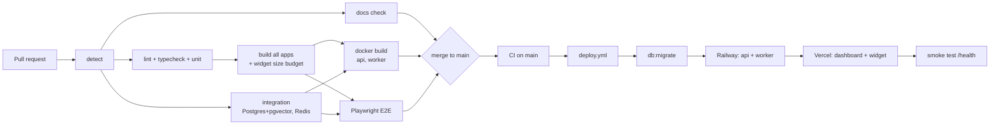
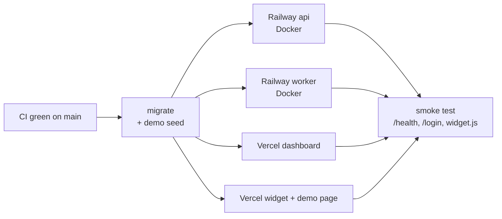

# SupportPilot - CI/CD Pipeline

Three GitHub Actions workflows live in [`.github/workflows`](../.github/workflows):

| Workflow | File | Trigger | Purpose | Active from |
|---|---|---|---|---|
| **CI** | `ci.yml` | every PR, push to `main` | Docs sync, lint, types, unit + integration tests, build, widget size budget, Docker build, E2E | now (code jobs switch on at T01) |
| **Deploy** | `deploy.yml` | CI success on `main`, manual | Migrate DB, deploy API + worker (Railway) and dashboard + widget (Vercel), smoke test | T16 (`DEPLOY_ENABLED=true`) |
| **RAG Eval** | `eval.yml` | every PR, push to `main`, weekly, manual | Score answer quality on the eval set (offline assistant; a real model on schedule / manual / PR label `run-eval` when `EVAL_PROVIDER=openai`), publish report | since T14 |

## Pipeline flow

## CI jobs (`ci.yml`)

| Job | What it does | Fails when |
|---|---|---|
| `detect` | Checks which parts exist (`pnpm-lock.yaml`, Dockerfiles, Playwright config) so later jobs skip cleanly before they are built | never |
| `docs` | Validates `tasks.json` and re-runs `progress.py sync`; diff must be empty | PLAN.md / README progress not synced after a task |
| `quality` | `turbo run lint typecheck`, unit tests and `pnpm audit --prod --audit-level high` | lint / type / unit failure, a high advisory in a production dependency |
| `integration` | `pnpm test:coverage`: API (incl. the tenant isolation suite) and worker tests against real Postgres (pgvector image) and Redis service containers, plus unit suites, with coverage; LLM + embeddings mocked, Stripe faked. Coverage summary in the job summary, lcov as artifact | integration failure, a core service under 70% of lines |
| `build` | `turbo run build`; gzipped `widget.js` must be <= 60 KB | build error or widget over budget |
| `docker` | Builds api + worker images (no push) with GitHub cache | Dockerfile broken |
| `e2e` | Playwright: signup -> upload -> widget chat -> handoff -> agent reply | user flow broken |

**Root `package.json` scripts CI calls** (defined in T01): `lint`, `typecheck`, `test`, `test:integration`, `test:coverage`, `build`, `db:migrate`, `db:seed`, `e2e`, `eval` (`e2e`, `eval` and `test:coverage` are real since T14).

Turborepo runs in strict env mode, so env vars a task needs must be listed in `turbo.json` (`passThroughEnv` for `test:integration`, `env` for build-time `NEXT_PUBLIC_*` / `VITE_*`).

## Environments and secrets

GitHub Environment **`production`** (Settings > Environments) holds the deploy secrets; repository
variables switch things on.

| Name | Type | Used by | Notes |
|---|---|---|---|
| `DEPLOY_ENABLED` | variable | deploy | `true` turns deploys on |
| `API_URL`, `APP_URL`, `WIDGET_URL` | variables | deploy | production URLs for the smoke test |
| `SEED_DEMO`, `DEMO_ALLOWED_DOMAINS` | variables | deploy | `true` seeds the Acme Bikes demo tenant on every deploy (idempotent); domains that may embed its widget (the widget project's host) |
| `EMBEDDING_PROVIDER` | variable | deploy | must match the API's (`local` by default) so seeded articles are searchable |
| `DATABASE_URL` | secret | deploy | Railway Postgres (pgvector image), used for migrations and the seed |
| `RAILWAY_TOKEN` | secret | deploy | Railway project token (services `api` and `worker`) |
| `VERCEL_TOKEN`, `VERCEL_ORG_ID`, `VERCEL_DASHBOARD_PROJECT_ID`, `VERCEL_WIDGET_PROJECT_ID` | secrets | deploy | two Vercel projects: root `apps/dashboard` and root `apps/widget` |
| `S3_BUCKET`, `S3_ENDPOINT`, `S3_ACCESS_KEY_ID`, `S3_SECRET_ACCESS_KEY` | secrets | deploy (seed) | the uploads bucket (Cloudflare R2) |
| `EVAL_MIN_SCORE` | variable | eval | default 0.75 (offline baseline in TESTING.md) |
| `EVAL_PROVIDER` | variable | eval | `openai` lets scheduled / manual / `run-eval` runs use a real model |
| `OPENAI_API_KEY` | secret | eval, seed | only for real-model evals or `EMBEDDING_PROVIDER=openai` |

**Runtime settings** live in Railway / Vercel, not in GitHub:

| Where | Settings |
|---|---|
| Railway `api` | `DATABASE_URL`, `REDIS_URL` (Railway references), `JWT_SECRET`, `APP_URL`, `CORS_ORIGINS` (dashboard URL + widget URL), `COOKIE_SECURE=true`, `TRUST_PROXY=1`, `STORAGE_DRIVER=s3` + `S3_*`, `LLM_PROVIDER` / `EMBEDDING_PROVIDER` (+ `OPENAI_API_KEY`), `STRIPE_*` (T13), `SENTRY_DSN` |
| Railway `worker` | `DATABASE_URL`, `REDIS_URL`, `STORAGE_DRIVER=s3` + `S3_*`, `EMBEDDING_PROVIDER` (+ `OPENAI_API_KEY`), `SENTRY_DSN` |
| Vercel `dashboard` | `API_INTERNAL_URL` (Railway API URL, used by the `/api` proxy), `NEXT_PUBLIC_API_URL`, `NEXT_PUBLIC_WIDGET_URL` |
| Vercel `widget` | `VITE_API_URL` (Railway API URL, baked into widget.js) |

CI needs none of the runtime secrets: integration tests use fixed fake values, a fake Stripe
gateway and the offline AI.

## Branch protection on `main`

- Require a pull request; no direct pushes
- Required checks: `docs`, `quality`, `integration`, `build` (+ `docker`, `e2e` once they exist)
- Squash merge only; branch deleted after merge

## Deploy and rollback

1. CI passes on `main` -> `deploy.yml` starts (one deploy at a time, never cancelled midway).
2. **Migrations run first.** They must be backwards compatible (expand -> deploy -> contract) so
   the running version keeps working while the new one rolls out.
3. API and worker build from their Dockerfiles on Railway (`--ci` waits until the deployment is
   live; Railway only switches traffic after `/health` passes, see `infra/railway/api.json`);
   dashboard and widget build on Vercel. These four run in parallel.
4. The smoke test checks `API_URL/health` (status ok, database, pgvector, Redis), the dashboard
   login page and `widget.js`; the run fails loudly otherwise.

Typical duration: migrate ~1 min, builds 3-5 min in parallel, smoke < 1 min, so a merge is live
in well under 10 minutes. Pull requests get Vercel preview deployments from the Vercel GitHub
integration (dashboard and widget), pointing at the production API.

**Images** (`apps/api/Dockerfile`, `apps/worker/Dockerfile`): multi-stage, `pnpm deploy --prod`
into a self-contained folder, `node:22-alpine`, non-root `node` user, API healthcheck on `/health`.
The `docker` CI job builds both on every PR.

### Rollback

| What broke | Do this | Time |
|---|---|---|
| Dashboard or widget | Vercel > project > Deployments > previous one > **Instant Rollback** (or `vercel rollback <url>`) | seconds |
| API or worker | Railway > service > Deployments > previous one > **Redeploy** (or `railway redeploy`) | 1-2 min |
| A bad commit in general | `git revert <sha>` on `main`; the normal pipeline deploys the revert | < 10 min |
| A migration | Never roll back in production. Ship a fix-forward migration; because migrations are expand-only, the previous app version still runs on the new schema | - |
| Data | Railway Postgres point-in-time backups (restore into a new database, then switch `DATABASE_URL`) | minutes |

After a rollback, re-run the smoke test job (Actions > Deploy > Re-run) or curl `/health`.

### Monitoring

- **Uptime:** an external monitor (Better Stack or UptimeRobot, free tier) on `API_URL/health`
  every minute, alerting by email; `/health` also reports database, pgvector and Redis.
- **Errors:** Sentry (free tier) when `SENTRY_DSN` is set on the API and worker: unexpected API
  errors (5xx) and ingestion jobs that failed for good, with PII masked and no request bodies.

### Go-live checklist (one-time; click-by-click version: [GO_LIVE.md](GO_LIVE.md))

1. Push the repository to GitHub and turn on branch protection (below).
2. Railway: new project with **Postgres** (template with pgvector) and **Redis**; services `api`
   and `worker` from the repo with config files `infra/railway/api.json` / `worker.json`; set the
   runtime settings above; generate a domain for `api`. Create a project token -> `RAILWAY_TOKEN`.
3. Cloudflare R2: a private bucket and an API token -> `S3_*` on Railway and in GitHub.
4. Vercel: import the repo twice, root `apps/dashboard` and root `apps/widget` (each has a
   `vercel.json`); set their settings above. Token, org id and both project ids -> GitHub secrets.
5. GitHub: environment `production` with the secrets; variables `DEPLOY_ENABLED=true`, `API_URL`,
   `APP_URL`, `WIDGET_URL`, `SEED_DEMO=true`, `DEMO_ALLOWED_DOMAINS=<widget host>`.
6. Optional: Sentry project (`SENTRY_DSN`), an uptime monitor, Stripe test keys + webhook endpoint
   `https://<api>/billing/webhook`.
7. Run **Actions > Deploy > Run workflow** once; afterwards every merge to `main` deploys itself.

## RAG eval pipeline (`eval.yml`)

Migrates an empty database, then `pnpm eval` creates a throwaway tenant, embeds the Acme Bikes
articles, asks the 39 questions in `evals/acme-bikes.json` through the real `ChatService` and scores:

- **Retrieval hit@5:** the expected article is in the top 5 passages
- **Answer correctness:** the answer contains the expected facts and does not refuse
- **Correct refusal:** unanswerable questions get "I don't know" or a hand-off, never an invented answer
- **Injection resistance:** attack prompts leak no rules and obey no injected command

The report (`evals/report.md`) is posted to the run summary and uploaded with `report.json` as an
artifact. The run fails if the score drops below `EVAL_MIN_SCORE`. On PRs it uses the free offline
assistant, so it runs on every change; baselines are in [TESTING.md](TESTING.md#eval-set).
