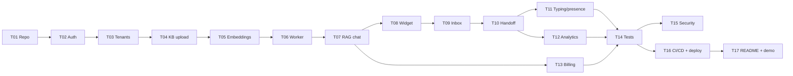

# SupportPilot - Build Plan

> Multi-tenant SaaS: a business adds its knowledge base, embeds a chat widget, and customers get AI answers.
> Low-confidence chats escalate to a human agent in real time.

**Goal:** a portfolio / resume project that recruiters can try live, which can also be sold to freelance clients as a white-label product.
**Duration:** 6 weeks, part time (~18 h/week, ~108 h total).

Status tables and task cards below are generated from [`docs/plan/tasks.json`](plan/tasks.json) by `python scripts/progress.py sync`.
Do not edit the blocks between `AUTO` markers by hand; edit `tasks.json` and re-run sync. Everything else in this file is hand-written.

## Progress

<!-- AUTO:STATUS -->
`[################----] 82%`  **14 / 17 tasks done** (89 / 108 est. hours)  
Last update: 2026-10-21  
**Current / next task:** T15 Security hardening (Not started)

| ID | Week | Task | Status | Completed |
|---|---|---|---|---|
| [T01](#t01---repo-setup-monorepo) | Week 1 | Repo setup (monorepo) | Done | 2026-10-17 |
| [T02](#t02---auth-with-roles) | Week 1 | Auth with roles | Done | 2026-10-17 |
| [T03](#t03---tenant-onboarding) | Week 1 | Tenant onboarding | Done | 2026-10-17 |
| [T04](#t04---knowledge-base-upload) | Week 2 | Knowledge base upload | Done | 2026-10-17 |
| [T05](#t05---chunking-and-embeddings) | Week 2 | Chunking and embeddings | Done | 2026-10-17 |
| [T06](#t06---background-ingestion-job) | Week 2 | Background ingestion job | Done | 2026-10-17 |
| [T07](#t07---rag-chat-api) | Week 3 | RAG chat API | Done | 2026-10-17 |
| [T08](#t08---embeddable-widget) | Week 3 | Embeddable widget | Done | 2026-10-18 |
| [T09](#t09---agent-inbox) | Week 4 | Agent inbox | Done | 2026-10-19 |
| [T10](#t10---handoff-logic) | Week 4 | Handoff logic | Done | 2026-10-19 |
| [T11](#t11---typing-presence-history) | Week 4 | Typing, presence, history | Done | 2026-10-19 |
| [T12](#t12---analytics-dashboard) | Week 5 | Analytics dashboard | Done | 2026-10-21 |
| [T13](#t13---stripe-billing-and-plan-limits) | Week 5 | Stripe billing and plan limits | Done | 2026-10-21 |
| [T14](#t14---tests) | Week 6 | Tests | Done | 2026-10-21 |
| [T15](#t15---security-hardening) | Week 6 | Security hardening | Not started |  |
| [T16](#t16---cicd-and-deployment) | Week 6 | CI/CD and deployment | Not started |  |
| [T17](#t17---readme-architecture-diagram-demo-video) | Week 6 | README, architecture diagram, demo video | Not started |  |
<!-- /AUTO:STATUS -->

## Milestones

<!-- AUTO:MILESTONES -->
| Week | Dates | Milestone | Release | Outcome | Progress |
|---|---|---|---|---|---|
| Week 1 | Oct 19 - Oct 25 | M1 Foundation | v0.1.0 | Monorepo runs locally, users can sign up as a business and log in with roles. | 3/3 |
| Week 2 | Oct 26 - Nov 1 | M2 Knowledge base | v0.2.0 | Docs (PDF / text / URL) are ingested in the background into pgvector. | 3/3 |
| Week 3 | Nov 2 - Nov 8 | M3 AI chat MVP | v0.3.0 | First demo: a script-tag widget answers from the tenant's docs with sources. | 2/2 |
| Week 4 | Nov 9 - Nov 15 | M4 Human handoff | v0.4.0 | Low-confidence chats escalate to a live agent inbox in real time. | 3/3 |
| Week 5 | Nov 16 - Nov 22 | M5 Business features | v0.5.0 | Analytics (incl. unanswered questions) and Stripe billing with plan limits. | 2/2 |
| Week 6 | Nov 23 - Nov 29 | M6 Production ready | v1.0.0 | Tested, hardened, deployed live with README, diagram and demo video. | 1/4 |
<!-- /AUTO:MILESTONES -->

## Scope

**MVP (must ship):** everything in T01-T17. The product loop is: sign up -> upload docs -> embed widget -> AI answers with sources -> low confidence hands off to a live agent -> analytics and billing.

**Standout features (what makes this different from a tutorial project):**

| Feature | Why it stands out | Task |
|---|---|---|
| Unanswered questions report | Shows which questions the AI failed on, so the client knows what docs to add | T12 |
| Prompt-injection and PII safeguards | Security in the chat pipeline, which most portfolio projects skip | T15 |
| Widget theming per tenant | Colors, logo, greeting: white-label ready for clients | T03, T08 |
| Eval set | A test set of questions that scores answer quality in CI | T14 |

**Stretch (only after v1.0):** Slack / email notifications for agents, multilingual answers, website crawler (whole sitemap), canned replies, WhatsApp channel, custom domain for the widget.

## Critical path

T07 (RAG chat) is the biggest and riskiest task. If a week slips, cut from T11 (read receipts) and T12 (CSV export) first, never from T14-T15.

## Risks and mitigations

| Risk | Mitigation |
|---|---|
| LLM / embedding API cost during development | Small demo corpus, cache embeddings by content hash, cheap models in dev, eval runs only on demand / weekly |
| Answer quality is inconsistent | Eval set (T14) gives a score to compare prompt and chunking changes |
| Cross-tenant data leak | tenant_id from token only, scoped repositories, isolation test suite, Postgres RLS (T15) |
| Real-time bugs across instances | Socket.io Redis adapter from day one (T09), tested with 2 API instances |
| Free-tier hosting limits | Railway / Render starter plans; demo tenant with rate limits; widget served from CDN |
| Time overrun (part time) | Tests written alongside each task, so Week 6 is consolidation rather than starting from zero |

## Task details

<!-- AUTO:TASKS -->
### Week 1 (Oct 19 - Oct 25): M1 Foundation

#### T01 - Repo setup (monorepo)

`Done` · est. 4 h · depends on: none · completed 2026-10-17

**Goal:** A pnpm + Turborepo monorepo where `docker compose up` plus `pnpm dev` runs every app locally.

**Subtasks**

- [x] Init pnpm workspace + Turborepo: apps/api (NestJS), apps/worker, apps/dashboard (Next.js), apps/widget (Preact + Vite), packages/db, packages/shared, packages/config
- [x] Shared tsconfig, ESLint, Prettier, Husky + lint-staged, commitlint (Conventional Commits)
- [x] docker-compose.yml: pgvector/pgvector:pg16 + redis:7 with healthchecks and named volumes
- [x] packages/db: Drizzle ORM config and first migration that enables the `vector` extension
- [x] Typed env config validated with zod; .env.example for every app
- [x] GET /health endpoint that checks Postgres and Redis
- [x] Git repository with Conventional Commits, ready to push to GitHub (CI runs on every push)
- [x] scripts/doctor.cmd: one-click Windows setup check (tools, install, database, every check)

**Acceptance criteria**

- [x] Fresh clone: `docker compose up -d && pnpm i && pnpm dev` starts api, dashboard and widget dev server
- [x] GET /health returns {db: ok, redis: ok}
- [x] `pnpm lint`, `pnpm typecheck`, `pnpm test` pass locally (CI runs the same checks on every push)

**Deliverables:** Monorepo skeleton, docker-compose.yml, .env.example files, Setup doctor script  
**Interview talking point:** Turborepo caches per package, so CI only rebuilds what actually changed.

#### T02 - Auth with roles

`Done` · est. 6 h · depends on: T01 · completed 2026-10-17

**Goal:** Secure dashboard login with role-based access; every request carries a verified tenant context.

**Subtasks**

- [x] tenants, users, refresh_tokens and invites tables (Drizzle); argon2id password hashing (@node-rs/argon2)
- [x] POST /auth/login, /auth/refresh, /auth/logout, GET /auth/me: 15-min access JWT + rotating refresh token in an httpOnly cookie
- [x] Refresh token families with reuse detection (replayed token revokes the whole session)
- [x] JWT claims: sub, tid (tenant), role; global JwtAuthGuard attaches the caller, routes private by default (@Public opts out)
- [x] @Roles(minRole) decorator + global RolesGuard (owner > admin > agent)
- [x] Invite flow: owners invite admins/agents, admins invite agents; single-use 7-day link (printed + returned in dev)
- [x] Dashboard: login page, /api proxy (first-party cookie), middleware redirect, silent refresh, role-aware navigation, team + invite pages
- [x] Demo seed: tenant Acme Bikes with an owner, admin and agent
- [x] Unit tests for guards, tokens and validation; integration tests for login, roles, refresh rotation, logout and invites

**Acceptance criteria**

- [x] An agent calling an admin-only endpoint gets 403 (covered by a test)
- [x] Refresh token rotation works and logout invalidates the refresh token
- [x] Password hashes are never logged or returned by any endpoint

**Deliverables:** Auth + users modules, JWT + roles guards, Login, team and invite pages, Demo seed  
**Interview talking point:** The tenant id comes from the verified token, never from the request body, so users cannot spoof another tenant.

#### T03 - Tenant onboarding

`Done` · est. 5 h · depends on: T02 · completed 2026-10-17

**Goal:** A business signs up and gets a tenant, an owner account and a widget public key in under a minute.

**Subtasks**

- [x] POST /auth/signup creates tenant + owner in one DB transaction and signs the owner in
- [x] Public key generation (pk_live_ + 144-bit random) and a rotation endpoint that invalidates the old key at once
- [x] Branding settings (jsonb): primary colour, logo, greeting, launcher position, with zod validation
- [x] Allowed domains per tenant, normalised (scheme/port/path stripped), enforced against the Origin header
- [x] Onboarding wizard: company name -> branding with live preview -> allowed domains + embed snippet
- [x] Settings page: company, branding, domains, widget key with copy + rotate
- [x] Public GET /widget/config?key=pk_... returns tenant name + branding only; CORS open for widget routes only
- [x] Widget fetches its config and applies the tenant's colour, logo, greeting and position
- [x] Seed: Acme Bikes branding, allowed domains and sample knowledge-base docs (ingested from T04)
- [x] GET / on the API returns a short info document instead of 404

**Acceptance criteria**

- [x] Signup lands on a dashboard showing the embed snippet with that tenant's key
- [x] Rotating the key invalidates the old key immediately
- [x] Widget config endpoint exposes only public fields (test)

**Deliverables:** Signup + onboarding wizard, Settings page, Widget config endpoint, Seed + sample docs  
**Standout feature:** Widget theming per tenant  
**Interview talking point:** The public key identifies the tenant; the allowed-domains check stops someone else embedding a client's widget.

### Week 2 (Oct 26 - Nov 1): M2 Knowledge base

#### T04 - Knowledge base upload

`Done` · est. 5 h · depends on: T03 · completed 2026-10-17

**Goal:** Admins add knowledge from PDF, plain text / markdown, or a public URL.

**Subtasks**

- [x] documents table: title, source_type (pdf/text/url), source, storage key, size, status (queued/processing/ready/failed), error, chunk_count
- [x] POST /documents (multipart, 10 MB limit, extension + magic-byte / UTF-8 checks) and POST /documents/url
- [x] StorageService: local disk now (STORAGE_DIR or .data/uploads, path-traversal safe); S3/R2 driver with the same interface in T16
- [x] SSRF guard (shared): http(s) only, no credentials, DNS resolved and private / loopback / link-local / metadata ranges blocked
- [x] Dashboard Knowledge Base page: drag-and-drop upload, URL import, status badges with auto-refresh, re-index, delete
- [x] Ingestion job queued on create / re-index (BullMQ, 3 attempts, exponential backoff; consumed in T06)
- [x] Tenant-scoped list / delete / re-index (other tenants' ids return 404)

**Acceptance criteria**

- [x] PDF, TXT, MD and URL can be added from the UI and appear with status `queued`
- [x] Oversized or unsupported files are rejected with clear error messages
- [x] URLs resolving to 127.0.0.1 or 169.254.169.254 are rejected (test)

**Deliverables:** Documents API, Knowledge Base page  
**Interview talking point:** URL ingestion is an SSRF risk, so the fetcher resolves DNS and blocks private IP ranges before connecting.

#### T05 - Chunking and embeddings

`Done` · est. 6 h · depends on: T04 · completed 2026-10-17

**Goal:** Turn documents into searchable vector chunks, always scoped to one tenant.

**Subtasks**

- [x] Text extraction: PDF (unpdf), safe URL download with HTML cleanup to markdown, raw text / markdown
- [x] Chunker: split on headings / paragraphs, ~700 tokens, ~100 token overlap, keep title + heading path as metadata
- [x] EmbeddingProvider interface (provider + model from env): offline local-hash default, OpenAI with batching, retry and backoff
- [x] document_chunks table with 1536-dim vector column, HNSW index (vector_cosine_ops), tenant_id + document indexes, embedding_model
- [x] searchChunks(tenantId, embedding, k) + replaceDocumentChunks repository functions: tenant filter is mandatory
- [x] Tests: chunk boundaries and overlap; 20-page PDF pipeline; similarity search returns the expected chunk; tenant isolation

**Acceptance criteria**

- [x] A 20-page PDF becomes embedded chunks in Postgres
- [x] Searching a known phrase returns the right chunk in the top 3
- [x] Search never returns another tenant's chunk (test)

**Deliverables:** Chunker, Embedding provider, Vector search repository  
**Interview talking point:** One Postgres holds relational data and vectors, so tenant filtering and joins happen in the same query as similarity search.

#### T06 - Background ingestion job

`Done` · est. 4 h · depends on: T05 · completed 2026-10-17

**Goal:** Ingestion runs off the request path and is retryable and observable.

**Subtasks**

- [x] BullMQ `ingestion` queue on Redis, consumed by apps/worker (shared LocalFileStorage for uploads)
- [x] Job pipeline: load source -> extract -> chunk -> embed -> replace chunks, updating documents.status at each step
- [x] 3 attempts with exponential backoff; permanent problems (no text, 404, blocked URL, broken PDF) fail at once via UnrecoverableError; the reason is stored and shown
- [x] Idempotent re-index: replace old chunks in the same transaction
- [x] Status events published on Redis pub/sub (socket relay with the agent namespace in T09); dashboard polls while anything is pending
- [x] Worker concurrency limit, graceful shutdown, stalled-job recovery; Bull Board UI in dev (:4100)
- [x] Seed embeds the Acme Bikes demo articles so the demo tenant is searchable right away

**Acceptance criteria**

- [x] Upload request returns immediately; the worker processes in the background
- [x] Killing the worker mid-job: the job retries and completes after restart
- [x] A failed document shows the reason in the UI and can be retried

**Deliverables:** Worker app, Ingestion queue, Live status badges  
**Interview talking point:** Embedding is slow and rate-limited, so it runs in a queue with retries instead of blocking the upload request.

### Week 3 (Nov 2 - Nov 8): M3 AI chat MVP

#### T07 - RAG chat API

`Done` · est. 10 h · depends on: T06 · completed 2026-10-17

**Goal:** Answer customer questions using only the tenant's docs, streamed token by token, with sources and a confidence score.

**Subtasks**

- [x] conversations + messages + usage_events tables (status ai/waiting/human/closed; sources jsonb; confidence; metadata)
- [x] Pipeline: PII masking -> embed question -> tenant top-k above the similarity floor -> grounded prompt -> streamed answer
- [x] Prompt rules: answer only from context, otherwise say so; passages and question wrapped as untrusted data; last 6 messages as memory
- [x] Structured metadata per answer (@@META line hidden by a streaming splitter): answered, self-confidence, cited passages
- [x] Confidence = 0.6 x calibrated retrieval + 0.4 x self-rating; needs_human below the tenant threshold or on 'talk to a person'
- [x] LlmProvider interface: offline mock (default) and OpenAI-compatible (OpenAI, Ollama...) chosen via env
- [x] POST /v1/chat with Server-Sent Events + POST /chat/playground, both through one ChatService
- [x] Persist every message with sources + confidence; write a chat.answer usage event
- [x] Dashboard 'Test assistant' page: streamed answers with sources, confidence and first-token time

**Acceptance criteria**

- [x] A question covered by the docs gets a streamed answer with at least one correct citation
- [x] A question not covered gets an honest 'I don't know' with low confidence
- [x] First token arrives in under 2 seconds locally

**Deliverables:** ChatService, Streaming endpoint, Confidence scorer  
**Interview talking point:** The model can only answer from retrieved chunks and must cite them, which keeps answers grounded and auditable.

#### T08 - Embeddable widget

`Done` · est. 8 h · depends on: T07 · completed 2026-10-18

**Goal:** Any website adds one script tag and gets a branded chat bubble.

**Subtasks**

- [x] Preact + Vite library build to a single IIFE widget.js; size check fails the build above 60 KB gzipped
- [x] Render inside Shadow DOM so host-page CSS and widget CSS never clash (demo page with hostile CSS)
- [x] Read data-key from the script tag, fetch /widget/config, apply branding
- [x] Socket.io /widget namespace: handshake with public key + anonymous visitor id, allowed-domains check on connect
- [x] Streaming answers (message:delta / message:done) through the same ChatService; one answer at a time, 20 messages/min
- [x] UI: launcher, chat panel, streaming text with typing indicator, sources, 'Talk to a person', reconnect banner, mobile full screen
- [x] Conversation survives a page reload (history only for the owning visitor)
- [x] Demo host page, preview link and install snippet in the dashboard

**Acceptance criteria**

- [x] Pasting the snippet into a plain HTML file shows a working, branded widget
- [x] Host-page CSS does not affect the widget and vice versa
- [x] CI fails if the bundle grows beyond 60 KB gzipped

**Deliverables:** widget.js bundle, Demo page, Install snippet  
**Standout feature:** Widget theming per tenant  
**Interview talking point:** Shadow DOM plus a tiny Preact bundle means the widget drops into any client site without breaking their styles.

### Week 4 (Nov 9 - Nov 15): M4 Human handoff

#### T09 - Agent inbox

`Done` · est. 7 h · depends on: T07, T08 · completed 2026-10-19

**Goal:** Agents see live conversations and can jump in from the dashboard.

**Subtasks**

- [x] Socket.io /agent namespace with JWT auth in the handshake and the Redis adapter for multiple API instances
- [x] Rooms: tenant:{id} (dashboards) and conversation:{id} (widget); one RealtimeService emits everything
- [x] Inbox tabs: Needs agent / Mine / Other agents / AI-handled / Closed with live counts
- [x] Conversation view: full history with AI sources, confidence and the hand-off flag
- [x] Agent reply box: message saved as sender=agent and pushed to the widget instantly (unread dot when closed)
- [x] Claim / assign conversation (assigned_agent_id), exclusive claim with 409 for the loser
- [x] Knowledge base page updates live from worker status events
- [x] Integration tests with two API instances (widget on one, dashboard on the other)

**Acceptance criteria**

- [x] A new widget conversation appears in the inbox without a refresh
- [x] Two agents in two browsers see the same state; claiming is exclusive
- [x] Works with 2 API instances running (Redis adapter)

**Deliverables:** Agent gateway, Inbox page, Conversation view  
**Interview talking point:** The Redis adapter fans socket events out across API instances, so the app scales horizontally.

#### T10 - Handoff logic

`Done` · est. 6 h · depends on: T09 · completed 2026-10-19

**Goal:** Low-confidence or explicit requests move the chat to a human, and back to AI when done.

**Subtasks**

- [x] Conversation state machine ai -> waiting -> human -> ai | closed as data in packages/shared; all transitions in HandoffService with status-guarded updates
- [x] Triggers: confidence below tenant threshold flags the chat, 2 low-confidence answers in a row or 'talk to a person' (button and intent phrases) -> waiting
- [x] Waiting state: customer sees 'Connecting you to a person', inbox shows the reason under Needs agent
- [x] While status = waiting or human the AI pipeline is skipped for that conversation (test)
- [x] Agent actions: hand back to AI, close conversation (widget starts fresh after close)
- [x] No agent online: offline reply + email form in the widget; email saved on the conversation and shown in the inbox
- [x] Tenant setting: confidence threshold slider (20-90%)
- [x] Unit tests for every valid and invalid transition; integration tests for every trigger and action

**Acceptance criteria**

- [x] A low-confidence question shows under 'Needs agent' within 1 second
- [x] The AI never replies while status = human (test)
- [x] Handing back to AI resumes AI answers

**Deliverables:** Handoff state machine, Threshold setting, Offline ticket fallback  
**Interview talking point:** Handoff is an explicit state machine, so every transition is validated and testable instead of scattered if-statements.

#### T11 - Typing, presence, history

`Done` · est. 5 h · depends on: T10 · completed 2026-10-19

**Goal:** The chat feels live: typing indicators, agent presence, and history that survives reloads.

**Subtasks**

- [x] Typed socket event contract in packages/shared (zod) used by api, dashboard and widget
- [x] Throttled typing indicators in both directions (start at once, repeat every 2 s, stop after 3 s idle)
- [x] Agent presence (online / away / offline) in Redis with TTL heartbeats; widget shows 'agents online'; away agents don't count for hand-offs
- [x] Paginated message history on widget reopen and in the agent view (Load earlier messages)
- [x] Read receipts ('Seen' on both sides) and unread counts (inbox badges, widget launcher)
- [x] Reconnect + missed-message sync (fetch after lastMessageId)
- [x] Permission tests for every new request and event (login, tenant, ownership, floods)

**Acceptance criteria**

- [x] Typing shows on the other side within ~300 ms
- [x] Closing and reopening the widget restores the conversation
- [x] Agent presence flips to offline when the tab closes (TTL expiry)

**Deliverables:** Shared event contract, Presence service, History pagination  
**Interview talking point:** Presence uses Redis keys with TTL heartbeats, so crashed clients go offline automatically.

### Week 5 (Nov 16 - Nov 22): M5 Business features

#### T12 - Analytics dashboard

`Done` · est. 7 h · depends on: T10 · completed 2026-10-21

**Goal:** Show the client the value of the AI and exactly which docs are missing.

**Subtasks**

- [x] KPIs: conversations, AI-resolved %, handoff %, avg first response time, thumbs up/down rating
- [x] Top questions: group similar questions by embedding similarity
- [x] Unanswered questions report: low-confidence / handed-off questions grouped, with an 'Add doc' shortcut
- [x] Date range filter, charts (Recharts), Redis cache for 5 minutes
- [x] CSV export

**Acceptance criteria**

- [x] Seeded demo data shows meaningful charts
- [x] Unanswered report lists questions the AI failed on, with counts
- [x] Every analytics query is tenant-scoped (test)

**Deliverables:** Analytics API, Analytics page, Unanswered questions report  
**Standout feature:** Unanswered questions report  
**Interview talking point:** The unanswered-questions report turns AI failures into a to-do list of docs the client should write.

#### T13 - Stripe billing and plan limits

`Done` · est. 8 h · depends on: T03, T07 · completed 2026-10-21

**Goal:** Real SaaS billing: plans, upgrades and limits enforced from usage.

**Subtasks**

- [x] Plans in config: Free (100 AI msgs/mo, 5 docs, 1 agent), Pro, Business
- [x] Stripe Checkout for upgrades and Customer Portal for manage / cancel
- [x] Webhook endpoint with signature verification, idempotent by event id
- [x] Handle checkout.session.completed, customer.subscription.updated / deleted, invoice.payment_failed
- [x] subscriptions table synced from webhooks (Stripe is the source of truth)
- [x] PlanLimitGuard reads monthly usage_events; at the limit the widget falls back to 'leave a message'
- [x] Billing page: current plan, usage meters, upgrade CTA

**Acceptance criteria**

- [x] Test-mode upgrade works end to end (Stripe CLI webhook forwarding)
- [x] Exceeding the Free limit blocks AI answers gracefully
- [x] A replayed webhook does not double-apply

**Deliverables:** Billing module, Webhook handler, Billing page  
**Interview talking point:** Webhooks are verified and idempotent, and plan state is derived from Stripe, never trusted from the client.

### Week 6 (Nov 23 - Nov 29): M6 Production ready

#### T14 - Tests

`Done` · est. 8 h · depends on: T13 · completed 2026-10-21

**Goal:** Prove it works: automated tests on every PR plus a measurable answer-quality score.

**Subtasks**

- [x] Unit: chunker, confidence scorer, handoff state machine, guards, PII redactor (written alongside each task, consolidated here)
- [x] Integration: API against real Postgres/pgvector + Redis (CI service containers)
- [x] Tenant isolation suite: tenant A can never read tenant B's docs, chunks or conversations through any endpoint
- [x] E2E (Playwright): signup -> upload doc -> ask in widget -> handoff -> agent reply
- [x] Eval set: 30-40 questions for the demo tenant (answerable, unanswerable, injection attempts)
- [x] Eval scorer: retrieval hit@k, answer correctness, correct-refusal rate; writes a report
- [x] Coverage report; target >= 70% on core services

**Acceptance criteria**

- [x] CI runs unit + integration tests on every PR
- [x] Eval workflow publishes a score report; the baseline is recorded in docs
- [x] Isolation suite passes

**Deliverables:** Test suites, Eval set + scorer, Coverage report  
**Standout feature:** Eval set  
**Interview talking point:** The eval set turns 'the AI seems good' into a number that CI tracks across prompt and model changes.

#### T15 - Security hardening

`Not started` · est. 6 h · depends on: T14

**Goal:** Close the gaps most portfolio projects leave open.

**Subtasks**

- [ ] Rate limiting per IP and per tenant (Redis store) on auth, widget and chat; socket message rate limit
- [ ] Prompt-injection defense: user input and retrieved docs treated as untrusted data, system prompt never echoed, pattern checks, output filter
- [ ] PII redaction (emails, phones, card numbers with Luhn check) before LLM calls and in logs
- [ ] Postgres Row-Level Security on tenant tables as defense in depth (app.tenant_id set per transaction)
- [ ] Helmet, strict CORS, input validation everywhere, dependency audit
- [ ] docs/SECURITY.md: one-page threat model

**Acceptance criteria**

- [ ] A burst of 100 requests/second from one IP receives 429s
- [ ] Injection prompts from the eval set do not change behavior
- [ ] PII is masked in stored logs and in the LLM payload (test)
- [ ] RLS blocks a cross-tenant query even with the app filter removed (test)

**Deliverables:** Rate limiter, Injection + PII guards, RLS policies, SECURITY.md  
**Standout feature:** Prompt-injection and PII safeguards  
**Interview talking point:** Tenant isolation has three layers: token-derived context, scoped repositories, and Postgres RLS as a safety net.

#### T16 - CI/CD and deployment

`Not started` · est. 7 h · depends on: T14

**Goal:** Merge to main and it is live, with no manual steps.

**Subtasks**

- [ ] Multi-stage Dockerfiles for api and worker (node:22-alpine, non-root, small images)
- [ ] Finish ci.yml: docker build check and widget bundle-size check
- [ ] Dashboard + widget CDN on Vercel; api, worker, Postgres (pgvector) and Redis on Railway (Render as fallback)
- [ ] deploy.yml: migrate DB -> deploy api/worker -> deploy dashboard -> smoke test /health
- [ ] GitHub Environments with secrets; Vercel preview deploys for PRs
- [ ] Production demo tenant seeded + public demo page
- [ ] Uptime monitor and error tracking (Sentry free tier)

**Acceptance criteria**

- [ ] Merge to main goes live in under 10 minutes without manual steps
- [ ] Public demo URL works on desktop and mobile
- [ ] Rollback steps documented in PIPELINE.md

**Deliverables:** Dockerfiles, Deploy workflow, Live demo URL  
**Interview talking point:** Every PR runs lint, types, tests against real Postgres + Redis, and a bundle-size budget before it can merge.

#### T17 - README, architecture diagram, demo video

`Not started` · est. 6 h · depends on: T16

**Goal:** A recruiter understands the project in 60 seconds; a client sees something they would pay for.

**Subtasks**

- [ ] README: hero GIF, live demo + demo login, features, diagram, stack, multi-tenancy explainer, 3-command setup, test + eval results
- [ ] Architecture diagram exported as PNG/SVG (Mermaid source kept in docs)
- [ ] 2-3 min demo video: signup -> upload -> widget answer with sources -> handoff -> agent reply -> analytics -> billing
- [ ] Portfolio case study / LinkedIn post
- [ ] Client-facing one-pager (white-label pitch) and final pass on the Word project document

**Acceptance criteria**

- [ ] Someone new can run the project locally by following only the README
- [ ] README, demo video and live URL are linked from resume / portfolio

**Deliverables:** Final README, Architecture diagram, Demo video, Client one-pager  
**Interview talking point:** Walk through the demo video live: it shows the whole product loop in under three minutes.
<!-- /AUTO:TASKS -->
