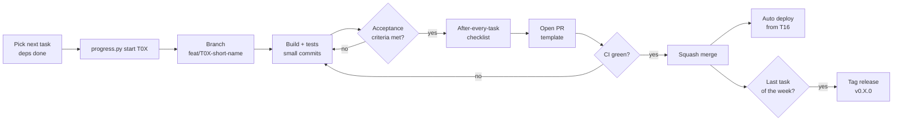

# SupportPilot - Development Workflow

How every task in [PLAN.md](PLAN.md) goes from *Not started* to *Done*, and how the docs stay current.

## Who does what

| Step | Claude | Akash |
|---|---|---|
| Pick the next task | Proposes it from PLAN.md (dependencies done) | Confirms or reorders |
| Build | Writes code + tests on a task branch | Reviews, runs it locally, asks for changes |
| Verify | Runs lint / types / tests, checks acceptance criteria | Clicks through the feature |
| Close out | Runs the after-every-task checklist below | Merges the PR |

## Task lifecycle



## Definition of Ready

A task can start when:

- every task in its `depends on` list is Done
- its subtasks and acceptance criteria in PLAN.md are still accurate (edit `tasks.json` first if not)

## Definition of Done

- All acceptance criteria are met and demonstrable
- Tests cover the new logic (unit for pure logic, integration for endpoints / DB)
- Every new query and socket event is tenant-scoped
- `pnpm lint && pnpm typecheck && pnpm test` pass; CI is green
- No secrets in code; new env vars added to `.env.example`
- The after-every-task checklist is complete

## After-every-task checklist

Run these in order once a task meets its acceptance criteria:

1. **Mark it done and sync every progress view** (one command):
   ```bash
   python scripts/progress.py done T0X --log "one-line summary of what was built"
   ```
   This updates `docs/plan/tasks.json`, regenerates the status, milestone and task blocks in `docs/PLAN.md`, the progress block in `README.md`, the Status / Completed on columns in `SupportPilot_Build_Plan.xlsx`, and rebuilds `SupportPilot_Project_Document.docx`.
2. **Expand the PROGRESS.md entry:** fill in Files, Verify, Decisions and Next using the template at the top of [PROGRESS.md](PROGRESS.md).
3. **Update ARCHITECTURE.md** if the task changed the design: remove the *(planned)* tag from sections that are now real, add new decisions to *Key decisions*.
4. **Update PIPELINE.md / workflows** if the task added a CI step, env var or secret.
5. **Re-run sync** if steps 2-4 changed anything shown in the Word doc: `python scripts/progress.py sync`.
6. **Commit** docs with the code in the same PR: `docs: mark T0X done`.

Starting a task: `python scripts/progress.py start T0X` (sets *In progress* everywhere).
Checking status any time: `python scripts/progress.py status`.

## Branches and commits

- `main` is always deployable and protected (see [PIPELINE.md](PIPELINE.md#branch-protection-on-main)).
- One branch per task: `feat/T04-kb-upload`, `fix/T07-stream-timeout`, `docs/T17-readme`.
- [Conventional Commits](https://www.conventionalcommits.org/), scoped by app, enforced by commitlint:
  - `feat(api): add document upload endpoint`
  - `feat(widget): render chat in shadow DOM`
  - `test(api): tenant isolation for chunk search`
  - `docs: mark T04 done`
- PRs use the [PR template](../.github/pull_request_template.md) and are squash-merged.

## Weekly releases

At the end of each week (when its milestone is complete), tag `main`:

| Week | Tag | Milestone |
|---|---|---|
| 1 | `v0.1.0` | Foundation |
| 2 | `v0.2.0` | Knowledge base |
| 3 | `v0.3.0` | AI chat MVP (first demo) |
| 4 | `v0.4.0` | Human handoff |
| 5 | `v0.5.0` | Business features |
| 6 | `v1.0.0` | Production ready |

Each tag gets GitHub release notes generated from the PROGRESS.md entries of that week. Recruiters can see the project grew steadily, not in one commit.

## Everyday commands

```bash
cp .env.example .env            # first time only
docker compose up -d            # Postgres (pgvector) + Redis
pnpm i                          # install
pnpm dev                        # api, worker, dashboard, widget in watch mode
pnpm dev:packages               # 2nd terminal, only when editing packages/shared or packages/db
pnpm db:migrate && pnpm db:seed # schema (+ demo tenant "Acme Bikes" from T03)
pnpm lint && pnpm typecheck && pnpm test
pnpm test:integration           # needs docker compose running
pnpm test:coverage              # unit + integration with coverage (coverage/SUMMARY.md)
pnpm e2e                        # Playwright end-to-end (starts or reuses pnpm dev)
pnpm eval                       # RAG eval set (offline by default; see docs/TESTING.md)
```

## Local setup notes (Windows)

- Run `scripts\doctor.cmd` (double-click works). It checks Node 22+, pnpm, Git, Docker (and starts Docker Desktop), Python
  + libs, then installs, starts the database, migrates and runs every check. The log goes to `.claude-logs\doctor.log`.
- `scripts\stop-dev.cmd` stops every leftover SupportPilot dev server (by repo path and ports 3000/4000/5173) and clears the dashboard's `.next` cache. The doctor runs it first, so `pnpm build` never fights a running `next dev` over `.next/`.
- Docker Postgres uses host port **5434** because this PC also has PostgreSQL 14 and 18 installed locally.
- The repo lives inside OneDrive. Pause OneDrive syncing while `pnpm install` runs the first time (OneDrive icon >
  Pause syncing > 2 hours); `node_modules` holds thousands of files. Moving the repo to e.g. `C:\dev\supportpilot` later
  is a plain folder move.
